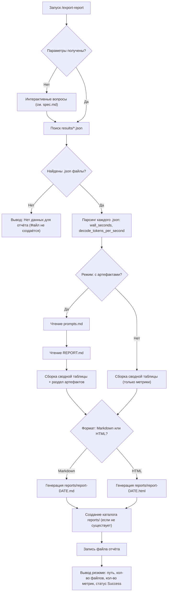

Этот файл составляла Kiro!

# Logic Specification: /export-report — генерация сводного отчёта

**Feature Branch**: `[001-export-report]`

**Created**: 2026-10-22

**Status**: Draft

**Companion to**: `.specify/specs/001-export-report/spec.md` (feature spec)

**Input**: Пользовательский запрос: спецификация логики команды `/export-report` с EARS-нотацией и Mermaid-диаграммой.

---

## 1. Область действия

Спецификация описывает внутреннюю логику команды `/export-report`: парсинг метрик из JSON-файлов результатов, чтение артефактов, формирование сводной таблицы, сохранение отчёта и обработку отсутствия данных.

UI-взаимодействие (вопросы о формате и составе) описано в `spec.md` и здесь не дублируется. Данная спецификация начинается с момента, когда параметры команды уже определены (формат вывода и режим состава).

### Входные источники

| Источник | Путь | Что извлекается |
|---|---|---|
| Метрики | `practices/practice_03/lab/results/*.json` | `wall_seconds`, `decode_tokens_per_second` |
| Артефакт 1 | `practices/practice_01/prompts.md` | Содержимое файла (текст) |
| Артефакт 2 | `practices/practice_03/REPORT.md` | Содержимое файла (текст) |

### Выходные артефакты

| Артефакт | Путь | Формат |
|---|---|---|
| Отчёт | `reports/report-YYYY-MM-DD.md` или `reports/report-YYYY-MM-DD.html` | Markdown или HTML |

### Структура JSON-файла результата (контракт)

Файлы `results/*.json` содержат ключи на верхнем уровне:

```json
{
  "wall_seconds": 5.71,
  "decode_tokens_per_second": 36.29,
  "total_seconds": 5.69,
  "load_seconds": 0.0008,
  ...
}
```

Для отчёта извлекаются **только** `wall_seconds` и `decode_tokens_per_second`. Остальные поля игнорируются.

---

## 2. Поток обработки (Mermaid)



---

## 3. Требования в EARS-нотации

### 3.1. Парсинг метрик

**FR-L01**: WHEN команда `/export-report` инициирует сбор данных, THE SYSTEM SHALL сканировать каталог `practices/practice_03/lab/results/` и выбрать все файлы с расширением `.json`.

**FR-L02**: WHILE парсинг каждого `.json`-файла выполняется, THE SYSTEM SHALL извлекать значения полей `wall_seconds` и `decode_tokens_per_second` с верхнего уровня JSON-объекта.

**FR-L03**: IF файл `.json` не может быть распарсен (повреждён, неверный формат, отсутствуют ключевые поля), THE SYSTEM SHALL пропустить файл, увеличить счётчик ошибок и продолжить обработку остальных файлов.

**FR-L04**: THE SYSTEM SHALL NOT извлекать метрики из файлов с расширением `.jsonl` — glob-паттерн строго `*.json`.

### 3.2. Чтение артефактов

**FR-L05**: WHEN выбран режим «с артефактами», THE SYSTEM SHALL читать файл `practices/practice_01/prompts.md` и включить его содержимое в раздел артефактов отчёта.

**FR-L06**: WHEN выбран режим «с артефактами», THE SYSTEM SHALL читать файл `practices/practice_03/REPORT.md` и включить его содержимое в раздел артефактов отчёта.

**FR-L07**: IF файл артефакта (`prompts.md` или `REPORT.md`) отсутствует, THE SYSTEM SHALL отметить его как «файл не найден» в соответствующем разделе отчёта и не прерывать генерацию.

**FR-L08**: WHEN выбран режим «только метрики», THE SYSTEM SHALL NOT читать файлы `prompts.md` или `REPORT.md`.

### 3.3. Формирование сводной таблицы

**FR-L09**: THE SYSTEM SHALL формировать сводную таблицу со столбцами: `Файл | Время, с | Скорость, tok/s`.

**FR-L10**: WHEN таблица формируется, THE SYSTEM SHALL использовать значение `wall_seconds` для столбца «Время» и `decode_tokens_per_second` для столбца «Скорость».

**FR-L11**: THE SYSTEM SHALL округлять значения в таблице до двух знаков после запятой.

**FR-L12**: THE SYSTEM SHALL сортировать строки таблицы по имени файла в алфавитном порядке.

**FR-L13**: THE SYSTEM SHALL включить строку со средними значениями (среднее арифметическое `wall_seconds` и `decode_tokens_per_second` по всем успешно распарсенным файлам) в конце таблицы.

### 3.4. Сохранение отчёта

**FR-L14**: THE SYSTEM SHALL сохранять отчёт в каталог `reports/` в корне проекта.

**FR-L15**: THE SYSTEM SHALL создавать каталог `reports/`, если он не существует.

**FR-L16**: WHEN формат отчёта — Markdown, THE SYSTEM SHALL сохранять файл с именем `report-YYYY-MM-DD.md`, где дата — локальная дата запуска.

**FR-L17**: WHEN формат отчёта — HTML, THE SYSTEM SHALL сохранять файл с именем `report-YYYY-MM-DD.html`, где дата — локальная дата запуска.

**FR-L18**: IF файл отчёта с тем же именем уже существует, THE SYSTEM SHALL перезаписать его.

### 3.5. Обработка отсутствия данных

**FR-L19**: WHEN в каталоге `practices/practice_03/lab/results/` не найдено ни одного `.json`-файла, THE SYSTEM SHALL вывести сообщение «Нет данных для отчёта» и не создавать файл.

**FR-L20**: IF все найденные `.json`-файлы повреждены и ни один не распарсен успешно, THE SYSTEM SHALL вывести сообщение «Нет данных для отчёта» и не создавать файл.

### 3.6. Ограничения чтения

**FR-L21**: THE SYSTEM SHALL NOT читать файлы из каталогов `node_modules/`, `.venv/`, `.git/`, `__pycache__/`.

**FR-L22**: THE SYSTEM SHALL читать источники только в режиме чтения; единственная операция записи — создание файла отчёта в `reports/`.

### 3.7. Вывод резюме

**FR-L23**: WHEN отчёт успешно сохранён, THE SYSTEM SHALL вывести резюме, содержащее:
- Путь к сохранённому файлу.
- Количество обработанных файлов.
- Количество извлечённых метрик.
- Количество файлов с ошибками парсинга (если > 0).
- Статус: `Success`.

**FR-L24**: WHEN отчёт не создан из-за отсутствия данных, THE SYSTEM SHALL вывести ровно «Нет данных для отчёта» без дополнительной информации.

---

## 4. Структура отчёта

### 4.1. Markdown-формат

```markdown
# Отчёт по результатам практик — YYYY-MM-DD

## Метрики

| Файл | Время, с | Скорость, tok/s |
|---|---|---|
| baseline.json | 5.71 | 36.29 |
| system.json | 4.38 | 37.64 |
| ... | ... | ... |
| **Среднее** | **X.XX** | **X.XX** |

## Артефакты

### practices/practice_01/prompts.md

<содержимое файла или «файл не найден»>

### practices/practice_03/REPORT.md

<содержимое файла или «файл не найден»>

---
Сгенерировано: YYYY-MM-DD HH:MM
Файлов обработано: N
Метрик извлечено: M
Ошибок парсинга: E
Статус: Success
```

### 4.2. HTML-формат

HTML-отчёт содержит те же разделы, оформленные в HTML-тегах. Таблица — `<table>`, артефакты — `<pre><code>`. Базовый CSS inline (без внешних зависимостей).

---

## 5. Матрица трассировки

| EARS-требование | Связь с feature spec | Проверка |
|---|---|---|
| FR-L01–L04 (парсинг) | FR-002 (источники) | Юнит-тест: парсинг тестовых JSON, пропуск .jsonl, пропуск битых файлов |
| FR-L05–L08 (артефакты) | FR-001 (состав) | Интеграционный тест: режим с артефактами и без |
| FR-L09–L13 (таблица) | FR-004 (резюме) | Юнит-тест: структура таблицы, сортировка, средние значения |
| FR-L14–L18 (сохранение) | FR-003 (файл отчёта) | Интеграционный тест: создание reports/, перезапись |
| FR-L19–L20 (нет данных) | FR-005 (нет данных) | Юнит-тест: пустой каталог, все битые файлы |
| FR-L21–L22 (границы) | FR-002 (исключения) | Интеграционный тест: файлы в node_modules не учитываются |
| FR-L23–L24 (резюме) | FR-004 (вывод) | Юнит-тест: формат резюме при успехе и при отсутствии данных |

---

## 6. Допущения

- Дата в имени файла — локальная дата запуска команды (не UTC).
- Значения `wall_seconds` и `decode_tokens_per_second` — числа (float) на верхнем уровне JSON. Вложенные или отсутствующие поля считаются ошибкой парсинга (FR-L03).
- `.jsonl`-файлы (логи OpenCode) исключаются по glob-паттерну `*.json` — отдельная фильтрация не требуется.
- Кодировка файлов — UTF-8.
- HTML-отчёт не требует внешних CSS/JS — всё inline.
- В v1 отсутствует пагинация и сжатие: весь объём данных помещается в один файл.
