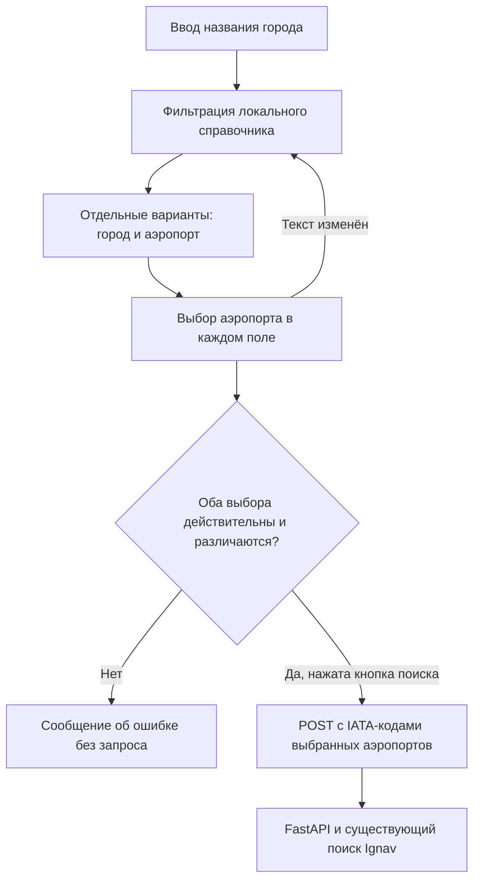

# Design

## Context

См. `proposal.md` — Why и `specs/city-airport-selection/spec.md`. В `practices/practice_05/frontend/src/App.tsx` оба поля сейчас ограничены регулярным выражением `[A-Za-z]{3}` и сразу становятся строками `origin`/`destination` в POST-запросе. `backend/app/schemas.py` принимает только трёхбуквенные IATA-коды; история, кеш и сравнение цен привязаны к этим кодам. В проекте пока нет справочника аэропортов или API подсказок.

## Goals / Non-Goals

**Goals:** отделить отображаемый текст города от выбранного кода аэропорта, оставить по одному выбранному аэропорту в каждом поле, сохранить один запрос по кнопке.

**Non-Goals:** искать одновременно по всем аэропортам города, предоставлять полный мировой справочник, выполнять запросы при вводе или менять контракт FastAPI.

## Decisions

- Использовать общий компонент выбора аэропорта для обоих полей и локальный массив записей `{city, airport, code}`. Начальный справочник: Москва — Шереметьево (SVO), Домодедово (DME), Внуково (VKO); Санкт-Петербург — Пулково (LED); Казань — Казань (KZN); Сочи — Сочи (AER). Коды и названия сверить с [поиском IATA](https://www.iata.org/codes/) при реализации. Альтернатива с внешним autocomplete API добавила бы сетевую зависимость и не нужна для согласованного небольшого охвата.
- Хранить отдельно текущий текст поля и выбранную запись. Любое редактирование после выбора сбрасывает запись; отправка формы разрешена только при двух действующих выборах. Это исключает отправку устаревшего кода при новом тексте. Альтернатива — выводить код из текста при отправке — неоднозначна для городов с несколькими аэропортами.
- Фильтровать предложения по названию города без учёта регистра и пробелов по краям. Подсказка показывает «город — аэропорт»; после выбора та же подпись остаётся в поле. Начальные значения обоих полей пустые, поскольку прежний `MOW` обозначал город целиком, а теперь нужен конкретный аэропорт. Альтернатива — заранее выбрать SVO — скрыла бы от пользователя этот выбор.
- Реализовать доступный список вариантов с управлением с клавиатуры и явным сообщением при отсутствии совпадений. Поиск остаётся в существующем `handleSubmit`: в тело запроса попадают только `code` выбранных записей. Альтернатива с отдельным серверным endpoint подсказок не нужна для локального справочника.

## Взаимодействие

Диаграмма показывает, что ввод и выбор остаются локальными. Код аэропорта попадает в существующий поиск только после нажатия кнопки.

## Risks / Trade-offs

- [Ограниченный справочник не содержит нужного города] → Показывать отсутствие совпадений и описать ограничение в документации; не подменять выбор произвольным IATA-кодом.
- [Код аэропорта не поддерживается Ignav] → Сверить записи с IATA перед выпуском и сохранить существующую серверную обработку ошибки провайдера.
- [Подсказки перекрывают поля на узком экране] → Проверить адаптивное расположение и управление с клавиатуры.
- [Изменение прежнего ввода IATA] → Обновить подписи, примеры и документацию; серверный API и сохранённая история остаются совместимыми.

## Migration Plan

Миграция данных не нужна: в API, кеше и SQLite сохраняются IATA-коды. Для отката достаточно вернуть прежние поля ввода и убрать локальный справочник.
