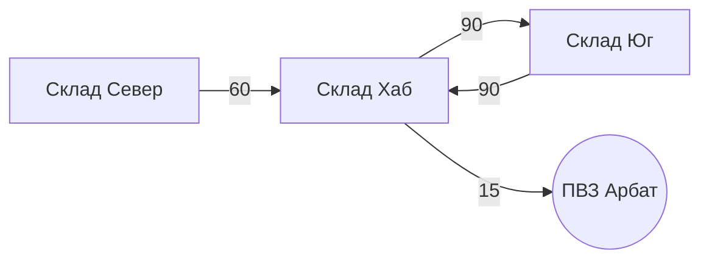
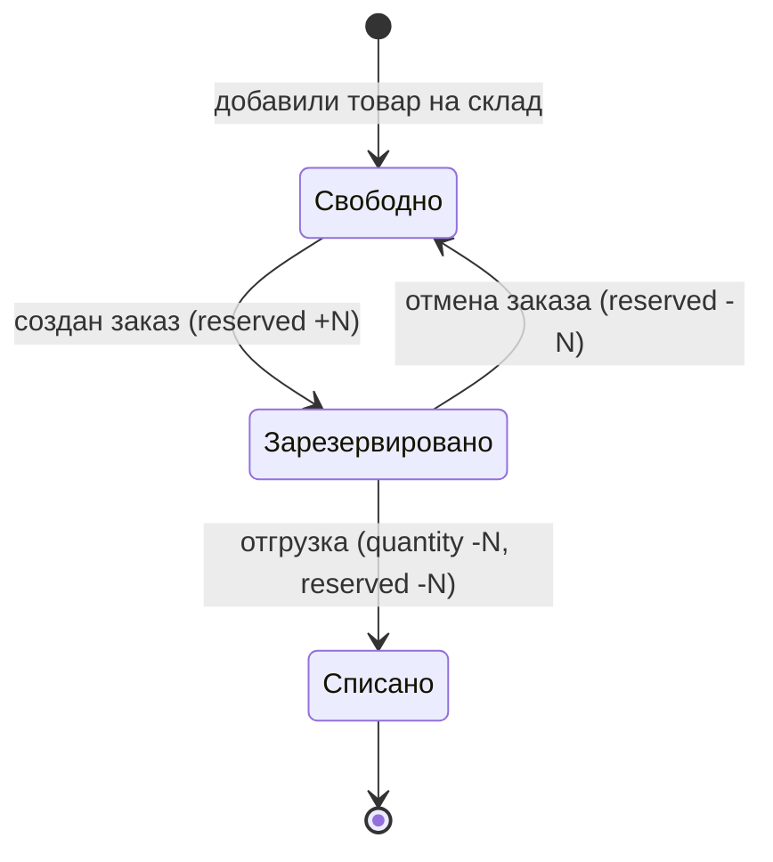
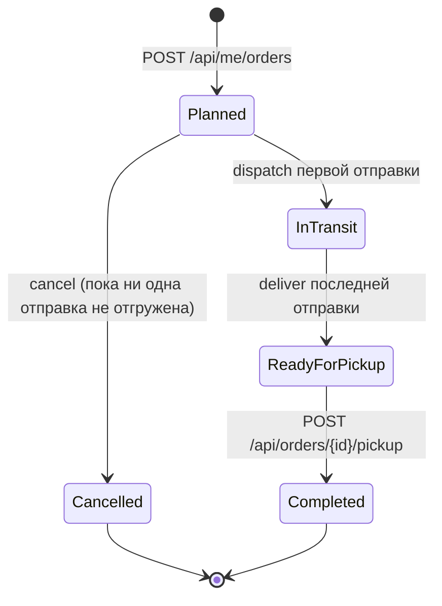

# Argon Logistics: бизнес-логика

Это человекочитаемая шпаргалка. Источник истины по поведению: `openspec/changes/argon-logistics-core/specs/*/spec.md`
(после `/opsx:archive` они переедут в `openspec/specs/`). Если здесь и в spec расхождение, прав spec.

Namespace: `Argonum.Logistics.*` (Core, Api, Tests).

## 1. Идея в одном абзаце

Есть общий каталог товаров. Товары лежат на складах в разном количестве. Склады соединены виртуальными путями
(ориентированный граф, у каждого пути время в минутах). ПВЗ привязаны к складам тоже путями с временем.
Клиент заказывает товары из каталога в любой активный ПВЗ. Система сама решает, с каких складов и по каким путям
везти, резервирует остатки и возвращает план: **какие товары, откуда, куда и за сколько минут**.
Везти можно только по существующим путям: если из склада нет пути в ПВЗ, его товар для этого заказа не существует.

## 2. Сущности

| Сущность | Поля | Ключевое правило |
|---|---|---|
| Товар (`Product`) | `sku`, `name`, `description` | `sku` уникален без учёта регистра (в т.ч. кириллица) |
| Склад (`Warehouse`) | `name`, `address`, `capacity`, `mapX`, `mapY` | `name` уникально без учёта регистра; `capacity` (1..10 000 000, по умолчанию 100 000) это максимум суммы `quantity` по всем строкам; позиция нужна только карте |
| Остаток (`StockItem`) | `warehouseId`, `productId`, `quantity`, `reserved` | `0 ≤ reserved ≤ quantity`, свободно = `quantity - reserved` |
| ПВЗ (`PickupPoint`) | `name`, `address`, `isActive`, `mapX`, `mapY` | неактивный не принимает новые заказы |
| Путь склад→склад (`WarehouseRoute`) | `from`, `to`, `minutes` | направленный, уникален по паре, без петель |
| Привязка склад→ПВЗ (`PickupPointLink`) | `pickupPointId`, `warehouseId`, `minutes` | направленная, `PUT` = upsert |
| Пользователь (`User`) | `name`, `email` | `email` уникален без учёта регистра |
| Заказ (`Order`) | пользователь, ПВЗ, статус, `estimatedMinutes`, позиции, отправки | хранит **снимки** названий и маршрутов |
| Отправка (`Shipment`) | склад-источник, статус, `totalMinutes`, маршрут, позиции | одна отправка на склад-источник |
| Возврат (`ReturnShipment`) | заказ, склад-получатель, статус, `totalMinutes`, маршрут от ПВЗ, позиции | одна на склад-получатель в рамках одного отказа; хранит снимки |

Пределы: минуты пути 1..10080; координаты карты по модулю до 100 000; количество в строке остатка 0..1 000 000; в заказе до 100 позиций, количество 1..100 000.

## 3. Граф доставки

- Узлы: склады и ПВЗ. Рёбра: пути склад→склад и привязки склад→ПВЗ. Из ПВЗ рёбер нет, поэтому через ПВЗ не проедешь.
- Рёбра **направленные**. `bidirectional: true` при создании пути создаёт два независимых ребра с одним временем.
- Склад **достижим**, если из него есть направленный путь в ПВЗ (напрямую по привязке или через другие склады).
- Кратчайший маршрут: минимум суммы минут; при равенстве меньше пересадок; затем меньший `id` следующего склада.
- Изменение/удаление путей **не пересчитывает** уже созданные заказы (маршрут в них снимок).

## 4. Алгоритм планирования

Вход: ПВЗ и список `(товар, количество)`. Строки с одним товаром суммируются.

1. Проверки: список не пуст, количества в пределах, ПВЗ существует и активен, все товары существуют.
2. Если у ПВЗ нет ни одной привязки: `409 pickup_point_unreachable`.
3. Одним Dijkstra по обратному графу от ПВЗ считаем время и маршрут для каждого достижимого склада.
4. Для каждого товара берём **свободное** количество (`quantity - reserved`) с достижимых складов от ближайшего к дальнему
   (при равенстве по `id` склада), пока не наберём нужное. Один товар может ехать с нескольких складов.
5. Если хоть одного товара не хватает: `409 insufficient_stock` со списком нехваток
   (`productId`, `requested`, `reachableAvailable`, `unreachableAvailable`). Частичного плана нет.
6. Позиции группируются в **отправки по складу-источнику**, порядок: время, затем `id` склада.
7. `estimatedMinutes` заказа = максимум `totalMinutes` отправок (отправки едут параллельно).

Пример (Север 4 шт., Юг 4 шт. молока; хлеб 2 шт. на Юге; заказ: молоко 6, хлеб 1):

| Отправка | Маршрут | Время | Позиции |
|---|---|---|---|
| Север | Север → Хаб → ПВЗ | 75 | молоко ×4 |
| Юг | Юг → Хаб → ПВЗ | 105 | молоко ×2, хлеб ×1 |

`estimatedMinutes` = 105. Жадный выбор «ближайшие первыми» минимизирует время самого дальнего источника для каждого товара.
Он **не** минимизирует число отправок (осознанный компромисс).

Dry-run: `POST /api/plans` считает то же самое, но ничего не резервирует и не создаёт.

## 5. Остатки и резерв

- Заказ **резервирует** остаток при создании, а не списывает. Физически товар лежит на складе до отгрузки.
- `PUT stock` не может поставить количество ниже `reserved` (`409 stock_below_reserved`).
- Удалить строку остатка с резервом нельзя (`409 stock_reserved`).
- Все операции, меняющие остатки, идут под одним замком (`InventoryLock`) и сохраняются одним `SaveChanges`.
  Два заказа на последнюю единицу: ровно один успешен, второй получает `409 insufficient_stock`.
  Это верно для одного инстанса API.

## 6. Жизненный цикл заказа и отправок

Отправка: `Planned → Dispatched → Delivered`, либо `Planned → Cancelled` вместе с отменой заказа.
Статус заказа вычисляется по отправкам; `Cancelled` и `Completed` ставятся только отменой и выдачей.
`dispatch` пишет `dispatchedAt` и `estimatedArrivalAt = dispatchedAt + totalMinutes`.
Недопустимый переход: `409 shipment_invalid_transition` / `order_invalid_transition` / `order_not_cancellable`.

## 7. Правила удаления

| Что удаляем | Запрещено, если | Что уходит вместе с ним |
|---|---|---|
| Товар | где-то есть остаток > 0 (`product_has_stock`) | нулевые строки остатков |
| Склад | остаток > 0 (`warehouse_not_empty`) или есть отправки `Planned`/`Dispatched` (`warehouse_has_shipments`) | пути от/до него, привязки к ПВЗ, нулевые остатки |
| ПВЗ | есть заказы `Planned`/`InTransit`/`ReadyForPickup` (`pickup_point_has_orders`) | привязки к складам |
| Строка остатка | `reserved > 0` (`stock_reserved`) | |

Заказы хранят снимки (SKU, название, склад, ПВЗ, маршрут), поэтому история переживает удаление товара/склада/ПВЗ/пути.

## 8. Клиент и оператор

- Клиент: `X-User-Id` (регистрация `POST /api/users`). Видит и отменяет **только свои** заказы, чужой заказ даёт `404 order_not_found`.
- Оператор (без аутентификации в этой версии): весь CRUD, `GET /api/orders`, dispatch/deliver, pickup.
- Каталог и список ПВЗ читаются теми же `GET`, что и в CRUD, отдельных клиентских копий нет.

## 8а. Вместимость склада

- Занято = сумма `quantity` по строкам остатка (резерв место **не** освобождает: товар физически лежит).
- Входящее = количество в возвратах `Planned`/`Dispatched`, идущих на склад. Свободно = `capacity − занято − входящее`.
- Инвариант: `занято + входящее ≤ capacity`. Его держат пополнение (`POST`/`PUT` остатка: `409 warehouse_capacity_exceeded`),
  смена вместимости (ниже занятого и входящего нельзя: `409 capacity_below_occupied`) и оформление возврата.
  Уменьшение остатка вместимостью не ограничено. Всё под `InventoryLock`, входящее считается запросом, а не хранится.
- Вместимость не влияет на планирование обычных заказов (товар уезжает со склада, место освобождается).

## 8б. Отказ от товара и возвраты

Клиент отказывается от товара, пока заказ `ReadyForPickup` (`POST /api/me/orders/{id}/returns`, часть или все позиции).
Отказ оформляется как обратная доставка ПВЗ → склад.

- **Направление.** В графе из ПВЗ нет рёбер, поэтому первый участок идёт по привязке склад → ПВЗ в обратную сторону с тем же
  временем (допущение: дорога одна и та же). Дальше по направленным путям между складами.
- **Выбор склада** (`ReturnPlanner`, чистая функция в Core). Dijkstra вперёд от ПВЗ со стоимостью `(минуты, пересадки)`.
  Позиции по возрастанию `productId`, каждая единица занимает свободное место ближайшего склада, затем следующего. Места на складах
  общие для всех позиций. Заполненный склад может быть транзитным: путь ПВЗ → A → B идёт через A, но место на A не занимается.
- **Нехватка места** суммарно на достижимых складах: `409 return_no_capacity` (`requested`, `reachableFree`), отказ целиком, данные не меняются.
- **Резерв места** на складе-получателе делается при оформлении (входящее), поэтому два отказа не займут одно место.
- **Жизненный цикл:** `Planned` → `Dispatched` → `Delivered`; при доставке остаток склада растёт (строка создаётся при отсутствии).
  Отмены возврата нет.
- **Статус заказа:** отказ от всех единиц всех позиций даёт конечный `Returned` (выдать нельзя); иначе заказ остаётся `ReadyForPickup`,
  `pickup` выдаёт оставшееся. `OrderItem.refusedQuantity` хранит, сколько вернули, от 0 до `quantity`.
- **Правила:** `refusal_exceeds_ordered` (больше неотказанного остатка позиции), `order_not_refusable` (заказ не `ReadyForPickup`),
  чужой заказ даёт `404 order_not_found`, форма запроса (пусто, количество < 1, повтор товара, товара нет в заказе) даёт `400`.
  Отказ разрешён и для неактивного ПВЗ (товар физически там).
- **Предпросмотр:** `POST /api/return-plans` (`pickupPointId`, `items`) возвращает план без побочных эффектов и без проверки заказа.
- **Оператор:** `POST /api/returns/{id}/dispatch` и `/deliver` (`return_invalid_transition`, `return_not_found`).
- Склад с возвратом `Planned`/`Dispatched` удалить нельзя (`warehouse_has_shipments`).
- **Симуляция** отгружает возврат через `DispatchDelaySeconds` после создания и доставляет по времени пути, как обычные отправки.

## 9. Формат ошибок

Всегда `application/problem+json` с полями `status`, `title`, `detail` и **`code`** (snake_case).
Валидация: `400 validation_failed` + `errors` по полям. Бизнес-конфликт: `409` + код. Данные при отказе не меняются.

Коды: `validation_failed`, `bad_request`, `user_unauthorized`, `product_not_found`, `warehouse_not_found`,
`pickup_point_not_found`, `pickup_link_not_found`, `route_not_found`, `stock_not_found`, `order_not_found`, `shipment_not_found`,
`user_not_found`, `product_sku_duplicate`, `warehouse_name_duplicate`, `user_email_duplicate`, `route_duplicate`,
`product_has_stock`, `warehouse_not_empty`, `warehouse_has_shipments`, `pickup_point_has_orders`, `pickup_point_inactive`,
`pickup_point_unreachable`, `insufficient_stock`, `stock_below_reserved`, `stock_reserved`, `order_not_cancellable`,
`order_invalid_transition`, `shipment_invalid_transition`, `warehouse_capacity_exceeded`, `capacity_below_occupied`,
`return_no_capacity`, `refusal_exceeds_ordered`, `order_not_refusable`, `return_invalid_transition`, `return_not_found`, `stock_inconsistent` (нарушение инварианта, не должно случаться).

## 10. Решения, которые принял я (проверь и поправь, если не так)

1. **Namespace `Argonum.Logistics`**. В задании было «Ar / Argonum», выбран полный вариант. Меняется переименованием.
2. **Пути направленные**, двусторонний путь это два ребра (флаг `bidirectional`).
3. **ПВЗ привязан к складам отдельными путями с временем**, а не к одному «хабу». Так ПВЗ может обслуживаться несколькими складами.
4. **Заказ планируется и резервируется сразу при создании.** Отдельной «ручки планирования» для заказа нет, есть dry-run `/api/plans`.
5. **Заказ выполняется целиком или отклоняется**, частичных заказов нет.
6. **Резерв, а не списание при заказе**; списание при отгрузке.
7. **Без аутентификации.** Клиент по заголовку `X-User-Id`, админские ручки открыты.
8. **Одна отправка на склад-источник, без консолидации** на транзитных складах.
9. **Возврат едет по привязке в обратную сторону с тем же временем**, место под него резервируется сразу, нехватка места отклоняет отказ целиком.
10. **Отказ только пока заказ готов к выдаче**; возврат уже выданного заказа не поддерживается.
11. **Вместимость по умолчанию 100 000**, а не «без ограничения».

## 11. Карта, симуляция и интерфейс

**Карта.** У склада и ПВЗ есть позиция `mapX`/`mapY` (условные единицы холста). Она не влияет на планирование: время пути задаёт
человек на связи, а не расстояние. Позицию можно передать при создании, обновить `PUT .../position`; обычный `PUT` объекта позицию не затирает.
`GET /api/network` отдаёт одним запросом склады (с `totalQuantity` и `totalReserved`), ПВЗ, пути и привязки.

**Симуляция** (`SimulationService`, фоновый сервис, по умолчанию выключен). Каждый тик (`TickMilliseconds`, 500 мс):
- отправка в статусе `Planned` отгружается через `DispatchDelaySeconds` после создания заказа;
- отправка в статусе `Dispatched` доставляется, когда `секунд с отгрузки × SpeedFactor ≥ totalMinutes`;
- выдача (`pickup`) остаётся действием человека: заказ ждёт в `ReadyForPickup`;
- отменённый заказ не отгружается, конфликт состояний (404/409 при гонке с ручным действием) игнорируется.
Симуляция вызывает те же `OrderService.DispatchAsync/DeliverAsync`, что и ручные ручки, поэтому резервы и статусы подчиняются тем же правилам.
`GET /api/simulation` отдаёт `enabled`, `speedFactor`, `dispatchDelaySeconds` и `serverTime` (по нему браузер выравнивает часы).

**Интерфейс (`web/`).**
- Склад: вместимость и шкала заполнения в панели свойств, бейдж «занято/вместимость» на карте.
- Карта: склады и ПВЗ перетаскиваются из панели «Строения»; связь создаётся протягиванием от точки у объекта, время задаётся в диалоге
  (в обе стороны это два пути). Протягивание от ПВЗ к складу разворачивается в привязку «склад → ПВЗ», «ПВЗ → ПВЗ» отклоняется.
- Панель свойств: переименование, активность ПВЗ, остатки склада, время и удаление связи. Отказы API показываются сообщением.
- Каталог товаров: CRUD и суммарный остаток.
- Планшет заказа: каталог, корзина (хранится в `localStorage`), выбор ПВЗ, предпросмотр плана (`/api/plans`) с подсветкой маршрутов,
  заказ от имени гостя (пользователь создаётся автоматически, `X-User-Id`). Отменить можно только свой заказ.
- Заказы: активные (`Planned`, `InTransit`, `ReadyForPickup`) и история, степпер статуса, отмена и «Получить».
- Грузовики: для каждой отправки `Dispatched` едет по участкам маршрута, время на участке пропорционально его минутам; положение
  вычисляется из `dispatchedAt`, `speedFactor` и серверного времени, поэтому после перезагрузки грузовик на правильном месте.
- Отказ от товара: у готового заказа (владелец-гость) кнопка «Отказаться от товара». Диалог: количество по позициям, предпросмотр
  `/api/return-plans` (склады-получатели, время, «через X: места нет» для транзитного склада), маршруты подсвечиваются на карте;
  при `return_no_capacity` кнопка отключена. В карточке секция «Возвраты» со статусами, полностью возвращённый заказ `Returned`
  («Возвращён») лежит в истории.
- Возвратные грузовики: те же правила движения, но от ПВЗ к складу (по привязке в обратную сторону), цвет и подпись «↩ #N»
  отличают их от доставки. У склада бейдж «занято/вместимость шт» (предупреждение от 90% с учётом входящих) и «↩ +N» для возвратов в пути.
- Данные обновляются опросом (SWR), не SSE.

## 12. Вне scope (сознательно)

Авторизация и роли, оплата, реальные координаты и расстояния (позиции на карте только для рисования), пропускная способность путей и
ёмкость складов, консолидация отправок, пагинация, идемпотентность создания заказа, частичные заказы, миграции БД (`EnsureCreated`),
несколько инстансов API (симуляция и `InventoryLock` рассчитаны на один процесс), мобильная раскладка интерфейса, push (SSE/WebSocket).
