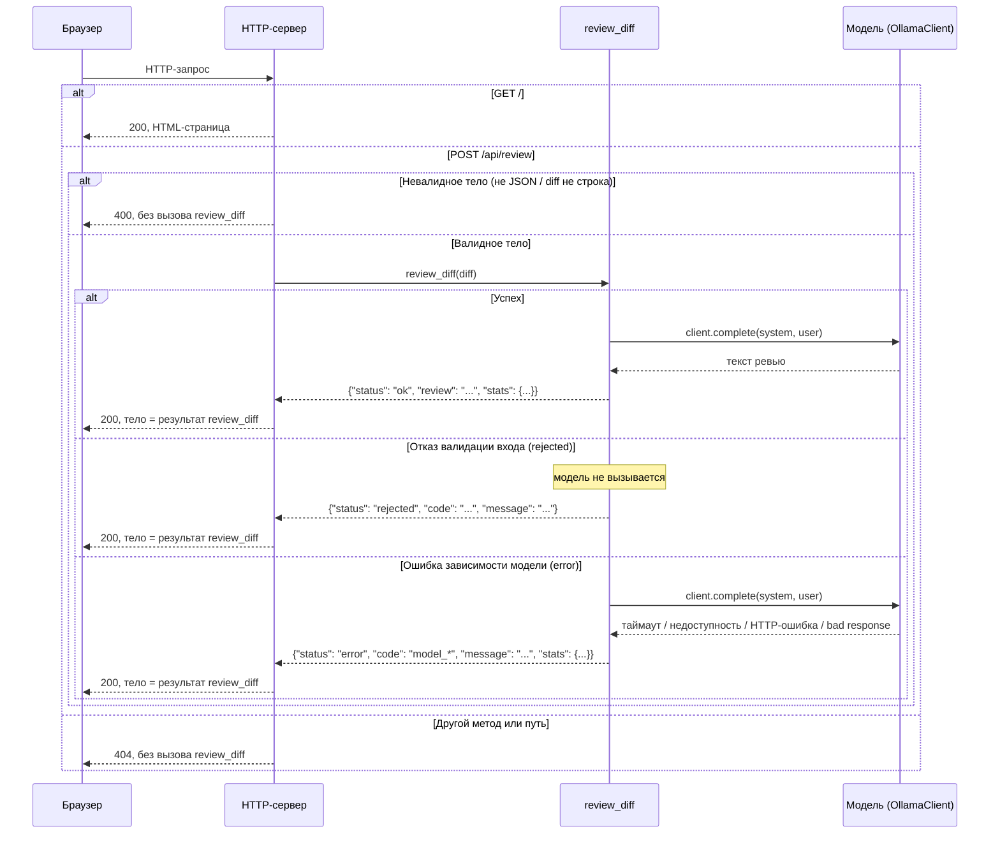

# Design

## Context

См. `proposal.md` - Why. Сейчас `review_diff(diff, client=None) -> dict`
(`app/review.py`) вызывается только из Python-кода и тестов: сети нет,
клиент инъектируется параметром. Контракт (`docs/requirements.md`)
запрещает менять сигнатуру `review_diff` и состав кодов. Эта фича
добавляет новый вызывающий слой — HTTP-сервер и HTML-страницу — поверх
существующей функции, без изменения её контракта.

Новый слой вводит цепочку взаимодействия, которой в проекте раньше не
было: браузер → HTTP-сервер (`http.server`) → `review_diff` →
`OllamaClient` → модель. Нужно зафиксировать, как HTTP-слой транслирует
три разных исхода `review_diff` (`ok`/`rejected`/`error`) в HTTP-ответ и
в интерфейс браузера, не путая их с собственными ошибками HTTP-слоя
(невалидный JSON, неизвестный маршрут).

## Goals / Non-Goals

**Goals:**
- Один процесс на `http.server` (`BaseHTTPRequestHandler` или
  `http.server.HTTPServer` с обработчиком), поднимаемый локально, без
  внешних зависимостей.
- `GET /` отдаёт статичную HTML-страницу (встроенную в код сервера или
  читаемую с диска) с полем для диффа, кнопкой и JS, который делает
  `fetch` на `/api/review` и отображает результат.
- `POST /api/review` — единственная точка вызова `review_diff`;
  разбор тела запроса, вызов `review_diff`, сериализация ответа.
- Разные визуальные состояния на странице: загрузка (запрос отправлен,
  ответа нет), успех (`ok`), отказ (`rejected`), ошибка модели (`error`),
  ошибка самого HTTP-слоя (400/404 — невалидный запрос или маршрут).

**Non-Goals:**
- Аутентификация, сессии, многопользовательский режим.
- Хранение истории ревью (БД, файлы) — каждый запрос независим.
- Стриминг ответа модели по мере генерации — ответ `review_diff`
  уже синхронный и полный.
- Конфигурируемость порта/хоста через аргументы командной строки за
  рамками переменных окружения, аналогичных `OLLAMA_URL`/`OLLAMA_MODEL`.
- Изменение `review_diff`, `subscribe` или `docs/requirements.md`.

## Decisions

**HTTP-сервер: `http.server.ThreadingHTTPServer` +
`BaseHTTPRequestHandler`, без фреймворка.**
Почему: единственная зависимость проекта — стандартная библиотека
(`docs/style-guide.md`, правило 5). `ThreadingHTTPServer` — часть
`http.server`, позволяет не блокировать второй запрос, пока первый ждёт
ответа модели (до `REVIEW_TIMEOUT_SECONDS = 30`). Альтернатива
(`HTTPServer`, однопоточный) была бы проще, но заблокировала бы страницу
на время одного ревью — не лучше для контроля приёмки, но хуже для
ручной проверки с несколькими вкладками.

**Маршрутизация вручную по `self.path` и `self.command` внутри
обработчика, без отдельного роутера.**
Почему: всего два маршрута (`GET /`, `POST /api/review`); роутер как
абстракция избыточен для двух условий и не даёт обучающей ценности,
которой требует проект (`AGENTS.md`: минимальное изменение).

**Статус-код ответа отражает, кто определил исход.**
`review_diff` сам решает про `ok`/`rejected`/`error` — это предусмотренные
исходы бизнес-логики, не ошибки транспорта, поэтому все три кодируются
HTTP 200 с телом JSON, отражающим `status`. HTTP-слой кодирует только
свои собственные отказы (невалидный JSON, отсутствующий путь) кодами
400/404. Альтернатива — транслировать `error`/`rejected` в HTTP
4xx/5xx — была отклонена: это добавило бы вторую классификацию ошибок
рядом с уже существующей в `review_diff`, и клиенту (JS на странице)
пришлось бы различать "мой запрос неверен" от "модель недоступна" по
HTTP-коду вместо поля `status`, которое уже есть в контракте.

Ниже — последовательность вызовов для всех веток: маршрутизация (GET /,
POST /api/review, прочее), а внутри POST /api/review — валидация тела
(400) и три исхода `review_diff` (`ok`, `rejected`, `error`).

**HTML/JS отдаются как встроенная в код сервера строка, без шаблонизатора
и без отдельного HTTP-сервера статики.**
Почему: одна страница, без параметризации по пользователю — шаблонизатор
не нужен и добавил бы либо зависимость, либо велосипед. Встраивание в код
проще, чем чтение файла с диска, при одной странице и соответствует
правилу "никаких зависимостей вне стандартной библиотеки".

**Разбор тела `POST /api/review`: `json.loads`, прямая проверка, что
результат — `dict` с ключом `"diff"` типа `str`.**
Почему: минимальная валидация, достаточная для отличия "клиент прислал
мусор" (400, без вызова `review_diff`) от "клиент прислал дифф" (вызов
`review_diff`, который сам отвечает за валидацию содержимого диффа).

## Risks / Trade-offs

- [Риск] `ThreadingHTTPServer` создаёt поток на подключение; при высокой
  параллельной нагрузке это не масштабируется → Митигация: не требуется —
  сервис учебный, однопользовательский; при необходимости масштабирования
  это отдельное решение вне этой фичи.
- [Риск] HTML встроен в код сервера строкой — неудобно редактировать как
  обычный `.html` файл → Митигация: приемлемо для одной небольшой
  страницы; если страница вырастет, можно вынести в отдельный файл в
  последующей фиче.
- [Риск] Ollama может отвечать до 30 секунд (`REVIEW_TIMEOUT_SECONDS`) —
  пользователь видит состояние загрузки всё это время → Митигация: это
  уже свойство `review_diff`/модели, не нового кода; состояние загрузки
  в UI — явное требование из `proposal.md`.

## Open Questions

(нет — конкретные решения по серверу, маршрутизации, кодам ответа и
разметке страницы зафиксированы выше; `tasks.md` детализирует их в шаги)
