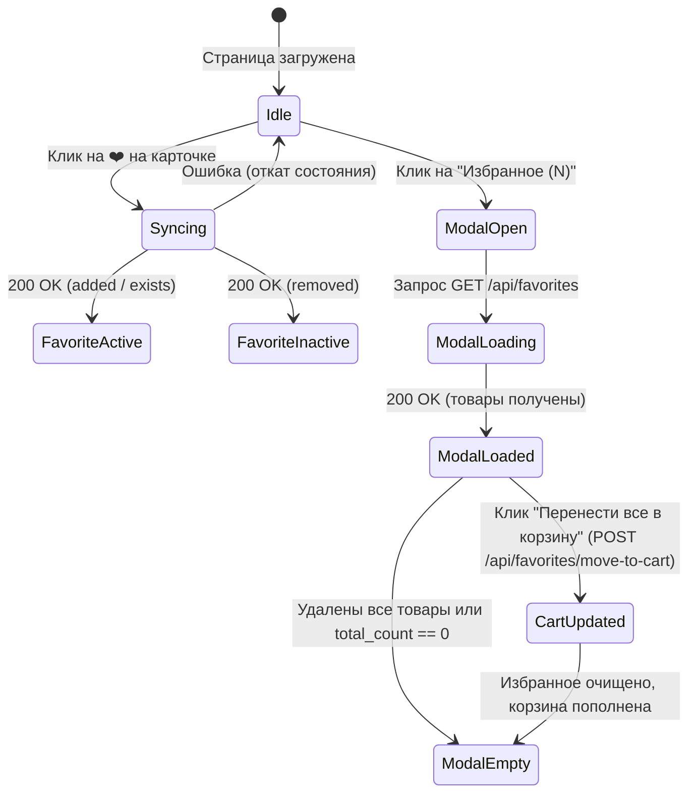

# Shared Contract: Favorites & Wishlist API
**Document ID:** `CONTRACT-VKUSMART-FAV-001`  
**SDD Framework:** Spec-Kit  
**Status:** APPROVED BY BOTH TEAMS  
**Sign-off:** Team UI (Lead) & Team Logic (Lead)  
**Date:** 2026-10-23  

---

## 1. Протокол согласования (Negotiation Log)

Во время сессии согласования между Командой 1 (UI) и Командой 2 (Логика) были выявлены 5 критических противоречий в драфтах спецификаций. Ниже зафиксированы принятые консенсусные решения:

| # | Предмет разногласий | Позиция UI (Draft 1) | Позиция Logic (Draft 2) | Итоговое решение (Contract) |
|---|---------------------|----------------------|-------------------------|-----------------------------|
| **1** | **Именование полей в JSON** | `camelCase` (`productId`, `userId`) | `snake_case` (`product_id`) | **`snake_case`** во всех запросах и ответах для единообразия с остальным VkusMart API. |
| **2** | **Пути и методы эндпоинтов** | `POST /api/favorites`, `DELETE /api/favorites/:id` | `POST /api/favorites/add`, `POST /api/favorites/remove` | **RESTful:** `GET /api/favorites`, `POST /api/favorites` (добавление), `DELETE /api/favorites` (удаление с телом JSON), а также `POST /api/favorites/remove` как fallback для простых клиентов. |
| **3** | **Содержимое ответа GET /api/favorites** | Только ID (`["prod-1"]`), полагался на локальный кэш | Только ID и timestamp (`{"items": [{"product_id": "...", "added_at": ...}]}`) | **Обогащенный объект (Enriched DTO):** Бэкенд возвращает полные данные о товарах (`Product.to_dict()`) + агрегированные показатели (`total_price`, `total_calories`, `total_count`). Это исключает расхождение цен и калорийности. |
| **4** | **Повторное добавление (Idempotency)** | UI хотел игнорировать повторы | Logic бросал ошибку `400 Bad Request` | **Идемпотентный `POST`:** Если товар уже в избранном, сервер возвращает статус `200 OK` с флагом `already_exists: true` и актуальным счетчиком. Ошибка 400 не генерируется, интерфейс не ломается при double-click. |
| **5** | **Перенос в корзину (Move to cart)** | UI хотел в цикле слать запросы на добавление каждого товара | Logic не планировал операцию переноса | **Атомарный эндпоинт `POST /api/favorites/move-to-cart`:** Сервер за одну транзакцию добавляет все товары из избранного в корзину и очищает избранное, возвращая обновленную корзину и очищенный список. |

---

## 2. Спецификация REST API

### Базовые правила
* **Content-Type:** `application/json; charset=utf-8`
* **Кодировка ошибок:**
  ```json
  {
    "error": "error_code_snake_case",
    "message": "Понятное для пользователя или разработчика описание ошибки"
  }
  ```

---

### 2.1. Получить список избранного
* **Метод:** `GET /api/favorites`
* **Request Headers:** `Accept: application/json`
* **Query параметры:** отсутствуют
* **Успешный ответ (`200 OK`):**
  ```json
  {
    "items": [
      {
        "id": "prod-1",
        "name": "Филе грудки индейки су-вид",
        "category": "meat_poultry",
        "price": 320.0,
        "calories": 120,
        "protein": 24.5,
        "fat": 1.8,
        "carbs": 0.5,
        "weight": "250 г",
        "tags": ["high_protein", "keto", "sugar_free", "gluten_free"],
        "allergens": [],
        "description": "...",
        "added_at": 1729641600.0
      }
    ],
    "total_count": 1,
    "total_price": 320.0,
    "total_calories": 120
  }
  ```

---

### 2.2. Добавить товар в избранное
* **Метод:** `POST /api/favorites`
* **Request Body:**
  ```json
  {
    "product_id": "prod-3"
  }
  ```
* **Валидация:**
  * `product_id` обязателен и должен быть непустой строкой.
  * Товар с данным `product_id` должен присутствовать в каталоге.
* **Успешный ответ при новом добавлении (`200 OK`):**
  ```json
  {
    "status": "added",
    "already_exists": false,
    "product_id": "prod-3",
    "total_count": 2
  }
  ```
* **Успешный ответ при повторном добавлении (`200 OK` - Идемпотентность):**
  ```json
  {
    "status": "exists",
    "already_exists": true,
    "product_id": "prod-3",
    "total_count": 2
  }
  ```
* **Ошибки:**
  * `400 Bad Request`: `{"error": "missing_product_id", "message": "Field 'product_id' is required"}`
  * `404 Not Found`: `{"error": "product_not_found", "message": "Product with id 'prod-999' not found in catalog"}`

---

### 2.3. Удалить товар из избранного
* **Метод:** `DELETE /api/favorites` (или `POST /api/favorites/remove`)
* **Request Body:**
  ```json
  {
    "product_id": "prod-3"
  }
  ```
* **Успешный ответ (`200 OK`):**
  ```json
  {
    "status": "removed",
    "product_id": "prod-3",
    "total_count": 1
  }
  ```
* **Ошибки:**
  * `400 Bad Request`: `{"error": "missing_product_id", "message": "Field 'product_id' is required"}`
  * `404 Not Found`: `{"error": "not_in_favorites", "message": "Product 'prod-3' is not in favorites"}`

---

### 2.4. Полная очистка избранного
* **Метод:** `POST /api/favorites/clear`
* **Request Body:** `{}`
* **Успешный ответ (`200 OK`):**
  ```json
  {
    "status": "cleared",
    "total_count": 0
  }
  ```

---

### 2.5. Атомарный перенос избранного в корзину
* **Метод:** `POST /api/favorites/move-to-cart`
* **Request Body:**
  ```json
  {
    "clear_favorites": true
  }
  ```
  *(по умолчанию `clear_favorites = true`: переносим товары и очищаем список избранного)*
* **Успешный ответ (`200 OK`):**
  ```json
  {
    "status": "moved_to_cart",
    "moved_items_count": 2,
    "cart": {
      "items": [
        {"product": {"id": "prod-1", "...": "..."}, "quantity": 1, "subtotal": 320.0}
      ],
      "total_price": 530.0,
      "total_calories": 280,
      "total_protein": 26.5
    },
    "favorites_count": 0
  }
  ```
* **Ошибки:**
  * `400 Bad Request`: если избранное было пустым — `{"error": "empty_favorites", "message": "Cannot move empty favorites list to cart"}`

---

## 3. Матрица состояний интерфейса (UI State Transitions)


