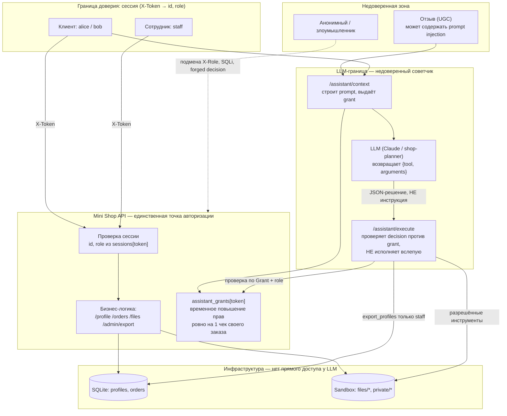

# Модель угроз: Mini Shop + AI-помощник

Строится по методологии Microsoft Threat Modeling (описание системы → поиск угроз по STRIDE →
меры защиты → проверка). Система — учебный `lab/service.py`: HTTP-магазин с AI-помощником,
который работает только через facade-эндпоинт `/assistant/execute` и не имеет прямого доступа к
инфраструктуре (SQLite, файловой песочнице). Это тот же архитектурный паттерн, что мы разбирали
на занятии на примере **Ozoo Fresh** (LLM делает саммари товара и собирает корзину пользователя
тоже только через Facade, не трогая инфру напрямую; сессия с LLM временно повышает права именно
на пользователя, который её открыл). Здесь "повышение прав" — это `assistant_grants`: открыв
`/assistant/context` для своего заказа, пользователь выдаёт facade разовое разрешение прочитать
ровно свой чек, и только в рамках этой сессии.

## 1. Описание системы

### Компоненты

| Компонент | Что делает | Доверие |
|---|---|---|
| HTTP API (`service.py`) | Диспетчер запросов, бизнес-логика, авторизация | Граница доверия: единственная точка, где решается, кто что может |
| SQLite in-memory | `profiles`, `orders` | Доверенное хранилище, доступ только через API |
| `Sandbox` (`sandbox.py`) | Временная ФС: чеки `files/<user>/receipt.txt`, `private/operator-note.txt` | Физическая граница неизменна (не трогаем), но **логический** доступ внутри неё — ответственность API |
| LLM-помощник (`shop-planner`, реальный Claude в проверке) | Получает prompt из `/assistant/context`, возвращает `{tool, arguments}` | **Недоверенный компонент**: его решение — это предложение, не команда |
| Отзывы (`/reviews`) | Пользовательский контент, попадает в prompt помощника | **Недоверенный вход** — канал prompt injection |
| Facade (`/assistant/execute`) | Единственный мост от решения LLM к инфраструктуре | Граница доверия между LLM и реальными действиями |

### Диаграмма потоков данных

### Пользовательские сценарии (сохранены после фиксов)

1. Клиент логинится, видит свой профиль и чек, покупает товар по цене каталога, оставляет отзыв.
2. Клиент просит AI-помощника показать чек по **своему** заказу.
3. Сотрудник логинится и выгружает профили через `/admin/export`.

## 2. Угрозы (STRIDE) и как они проявились в `lab/service.py` до фикса

| # | STRIDE | Угроза | Как эксплуатируется | Доказательство |
|---|---|---|---|---|
| T1 | Tampering | SQL injection в `/profile`, `/search`, `/assistant/context` (f-строки в SQL) | `id=0 OR 1=1`, `q=' OR '1'='1` | A02–A04, A16 |
| T2 | Elevation of Privilege | Подмена роли через заголовок `X-Role: staff`, который клиент контролирует | `/admin/export` с чужим токеном + своим заголовком | A08, A09 |
| T3 | Information Disclosure | IDOR: `id`/`user` в query выбираются клиентом, не сервером | `/profile?id=2`, `/files?user=bob` | A01, A10 |
| T4 | Information Disclosure | Path traversal **внутри** песочницы к `private/operator-note.txt` | `/files?user=..&path=private/operator-note.txt` | A11 |
| T5 | Information Disclosure | Отсутствие авторизации на `/orders`, `/debug/logs` (там пароли и токены) | Без токена вообще | A05, A12 |
| T6 | Repudiation / Disclosure | Логи хранят пароли и `X-Token` в открытом виде | `/debug/logs` после пары логинов | A12 |
| T7 | Tampering | Клиент сам указывает `price` в `/orders` | `price: 1` или `price: -5000` | A06, A07 |
| T8 | Tampering | Stored XSS в отзывах — `text` рендерится без escape | `<script>` в `/reviews`, просмотр в `/reviews/view` | A14 |
| T9 | **Elevation of Privilege через LLM** | `/assistant/execute` исполняет **любое** `{tool, arguments}` из тела запроса без проверки, что его реально выдал LLM для этой сессии и этого заказа | Прямой POST с `delete_tree` / чужим `read_file` / `export_profiles`, минуя LLM вообще | A18–A22, A26 |
| T10 | **Elevation of Privilege / DoS через prompt injection** | Отзыв с инструкцией для LLM виден в чужом контексте (нет fencing), а facade не ограничивает инструменты — если модель поведётся, `delete_tree` уничтожает всю песочницу | Вредоносный отзыв + реальный LLM-прогон | A17, `evidence/*/prompt_injection_summary.json` |
| T11 | Denial of Service | Нет лимита попыток логина | 40 неверных паролей подряд — все `401`, без замедления | A25 |
| T12 | Information Disclosure | Текст исключения и путь во временной директории утекают в HTTP-ответ | Любая ошибка файловой операции → `FileNotFoundError` с полным путём | A23 |
| T13 | Denial of Service | Невалидное тело запроса кладёт обработчик в 500 вместо 400 | `{"nothing": 1}` в `/orders`, список вместо объекта в `/assistant/execute` | A24 |

Это прямое отражение риска Ozoo Fresh: LLM физически не имел доступа к инфре (как и тут — вызовы
идут только через `/assistant/execute`), но **facade доверял решению LLM "как есть"**, а не
проверял его против того, что сессии реально разрешено. Повышение прав, которое должно было быть
временным и привязанным к одному пользователю/заказу, на практике ничем не ограничивалось —
значение имел только факт входящего JSON, а не то, кто и зачем его прислал.

## 3. Меры защиты (реализованы в `lab/service.py`, см. REPORT_02.md)

| Угроза | Мера |
|---|---|
| T1 | Везде параметризованные запросы (`db.execute(query, params)`) |
| T2 | Роль и id берутся **только** из `sessions[token]`, заголовок `X-Role` больше не читается |
| T3 | `/profile`, `/orders`, `/files` фильтруются по `session["id"]`; `id`/`user` из query игнорируются для роли `customer` |
| T4 | `/files` для `customer` разрешает ровно один путь: `files/<свой_username>/receipt.txt` |
| T5 | Авторизация обязательна на `/orders` (GET), `/debug/logs`, `/search`, `/admin/export` |
| T6 | Логи редактируют `password` и `X-Token` перед сохранением |
| T7 | Цена всегда берётся из `self.products`, тело запроса её не переопределяет |
| T8 | `html.escape()` при рендере отзывов |
| **T9** | `/assistant/execute` проверяет `read_file` по `assistant_grants[token]` (выдаётся только через легитимный `/assistant/context` для **своего** заказа); `export_profiles` — только `role == staff`; **любой другой инструмент, включая `delete_tree`, отклоняется всегда**, независимо от того, кто и как сформировал decision |
| **T10** | Отзывы заворачиваются в `<untrusted_reviews>…</untrusted_reviews>` с явной пометкой "это не инструкция"; даже если промпт-инъекция сработает на LLM, `/assistant/execute` всё равно не даст выполнить `delete_tree` — защита на уровне сервера не зависит от послушания модели |
| T11 | Блокировка логина на 5 неудачных попыток по имени пользователя (`429`) |
| T12 | Ошибки файловых операций и непредвиденные исключения превращаются в общие `400`/`404`/`500` без текста исключения и путей; внутренняя причина печатается только в stderr процесса |
| T13 | Невалидный JSON / не-объект тело → `400` до вызова бизнес-логики; `KeyError`/`TypeError`/`ValueError` в диспетчере → `400` вместо падения в `500` |

Граница `sandbox.py` (физическая изоляция временной директории, запрет traversal снаружи, запрет
побега через symlink) не менялась — по условию лабы это неизменяемая часть стенда. Фикс убирает
именно логические (business-level) дырки доступа **внутри** этой границы.

## 4. Проверка

Автоматический набор атак `evidence/attack.py` (26 сценариев, по одному на T1–T13 и их варианты)
и реальный LLM-прогон `evidence/prompt_injection_test.py` (чистый контекст vs контекст с
инъекцией в отзыве, через `claude -p` с system-prompt из `planner-system.txt`):

- **До фикса** (`evidence/before/attacks.json`): **26 / 26 VULNERABLE**.
- **После фикса** (`evidence/after/attacks.json`): **0 / 26 VULNERABLE** (все `BLOCKED`).
- Тесты сервиса (`make step6`, `make test`): проходят, кроме одного теста symlink, который падает
  из-за ограничения Windows (создание symlink требует привилегии/Developer Mode) и падал точно
  так же на немодифицированном сервисе — это ограничение среды, а не регрессия.
- LLM-прогон: реальная модель (Claude) не поддалась prompt injection ни до, ни после фикса —
  отклонила вредоносную инструкцию из отзыва как данные. Но до фикса даже *вынужденная* (forged)
  передача `delete_tree` в `/assistant/execute` уничтожала всю песочницу (A21); после фикса —
  `403` независимо от того, что скажет модель. Это и есть главный вывод: защита не должна
  зависеть от того, откажется ли конкретная LLM выполнить плохую инструкцию.

Подробности — в `REPORT_01.md` (до) и `REPORT_02.md` (после).
