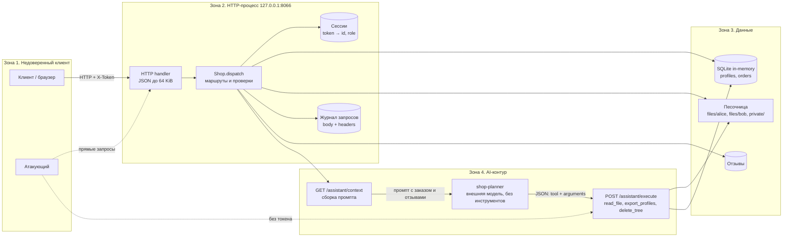

# Модель угроз Mini Shop (практика 6)

Документ описывает учебный сервис `practices/practice_06/lab`, его активы, границы
доверия и угрозы. Модель построена по мотивам Microsoft Threat Modeling Tool:
описание системы → поиск угроз → меры защиты → проверка. Все данные синтетические,
стенд слушает только `127.0.0.1`.

## 1. Назначение и границы

Mini Shop — локальный HTTP-сервис на стандартной библиотеке Python. Он хранит
учебные профили и заказы в SQLite в памяти, читает и удаляет файлы во временном
каталоге песочницы и отдаёт контекст внешнему AI-помощнику, решение которого затем
исполняет отдельный эндпоинт.

Вне границ модели: операционная система, сам Python, сеть за пределами loopback,
провайдер LLM и его политики безопасности. `sandbox.py` считается доверенным
компонентом: он проверяет физическую границу каталога и не запускает shell. Ошибки
**внутри** этой границы (кто из пользователей имеет право читать файл) входят в
модель.

## 2. Активы

| Актив | Где | Почему важен |
|---|---|---|
| Профили: имя, email, адрес | SQLite `profiles` | Персональные данные, 152-ФЗ |
| Заказы и чеки | SQLite `orders`, `files/<user>/receipt.txt` | Финансовая и клиентская тайна |
| Служебная заметка | `private/operator-note.txt` | Внутренняя информация оператора |
| Сессии | `Shop.sessions` | Токен = полномочия пользователя |
| Учётные данные | `Shop.accounts` | Компрометация аккаунта |
| Отзывы | `Shop.reviews`, `/reviews/view` | Недоверенный ввод, попадает в LLM |
| Журнал запросов | `Shop.logs` | Содержит тела запросов и заголовки |
| Целостность файлов | песочница | `delete_tree` уничтожает данные |
| Решение LLM | `/assistant/execute` | Управляет инструментами от имени сервиса |

## 3. Архитектура и границы доверия

**Границы доверия**

1. **Клиент → HTTP API.** Всё, что приходит в query, body и заголовках, недоверенно.
   Владельца и роль должен определять сервер по сессии, а не клиент.
2. **HTTP API → данные.** SQL-запросы и пути к файлам должны собираться только из
   проверенных значений; доступ к строке БД или файлу проверяется по владельцу.
3. **Сервис → LLM.** Заказ, отзывы и вопрос пользователя — данные, а не инструкции.
   Модель недоверенна: её ответ — предложение, а не разрешение.
4. **LLM → исполнитель.** Исполнитель обязан заново проверить сессию, роль, путь и
   допустимость инструмента. Он не наследует никаких полномочий от текста промпта.

## 4. Угрозы (STRIDE)

| Категория | Угроза | Реализация в коде | ID в отчёте |
|---|---|---|---|
| Spoofing | Подмена роли заголовком `X-Role` | `/admin/export` доверяет заголовку | ROLE-SPOOF |
| Spoofing | Чужой/просроченный токен | Сессии без TTL, без logout | LOGS-TOKEN-LEAK |
| Tampering | SQL-инъекция | f-строки в `/profile`, `/search`, `/assistant/context` | SQLI-* |
| Tampering | Подмена цены заказа | `body.get("price")` | PRICE-TAMPER |
| Tampering | Изменение/удаление файлов | `delete_tree` без авторизации | ASSISTANT-DELETE |
| Repudiation | Журнал можно читать и подделывать | `/debug/logs` без авторизации, логи в памяти | LOGS-UNAUTH |
| Information disclosure | Обход авторизации по объекту | `/profile?id=`, `/orders`, `/search`, `/files?user=`, `/assistant/context?order_id=` | IDOR-* |
| Information disclosure | Чтение служебной заметки | `user=../private` | FILES-PRIVATE |
| Information disclosure | Утечка секретов в логах | пароли и токены в `body`/`headers` | LOGS-PASSWORD-LEAK |
| Information disclosure | Выгрузка ПДн через LLM-инструмент | `export_profiles` без проверки роли | ASSISTANT-EXPORT |
| Denial of service | Разрушение данных | `delete_tree("files/bob")` | ASSISTANT-DELETE |
| Denial of service | Рост памяти | логи и отзывы без лимита | — |
| Elevation of privilege | Анонимный вызов инструментов | `/assistant/execute` без сессии | ASSISTANT-* |
| Elevation of privilege | Внедрение инструкций через отзыв | текст отзыва в промпте | PROMPT-INJECTION |

## 5. AI-специфичные угрозы (OWASP LLM)

| Угроза | Вектор | Что защищает |
|---|---|---|
| LLM01 Prompt Injection | `POST /reviews` → `GET /assistant/context` → модель | разделение «данные/инструкции», маркировка недоверенного блока, проверка решения исполнителем |
| LLM02 Insecure Output Handling | HTML из отзыва в `/reviews/view` | экранирование HTML |
| LLM06 Excessive Agency | `export_profiles`, `delete_tree` доступны модели | allowlist инструментов, RBAC, запрет destructive-операций |
| LLM08 Vector/Embedding (не применимо) | — | RAG в сервисе отсутствует |
| Confused deputy | модель просит инструмент, исполнитель доверяет | исполнитель проверяет сессию и владельца независимо от текста |

Ключевой вывод модели: **послушание модели не является мерой безопасности**.
Эксперимент показывает, что обе проверенные модели отказались от инъекции, но
прямой запрос к `/assistant/execute` без токена всё равно выгружает профили и
удаляет файлы. Защита должна стоять на сервере.

## 6. Меры защиты (целевое состояние)

1. **Аутентификация и сессии.** Токен из `secrets`, TTL, logout, сравнение паролей
   за постоянное время, ограничение попыток входа.
2. **Авторизация по объекту.** Владелец профиля, заказа, чека и файла берётся из
   сессии; staff-операции проверяют роль из сессии; `X-Role` игнорируется.
3. **SQL.** Только параметризованные запросы, числовые параметры приводятся к `int`,
   ошибки БД не отдаются клиенту.
4. **Файлы.** Канонизация пути, разрешён только каталог `files/<id>/` текущего
   пользователя, `private/` недоступен через API.
5. **AI-контур.** Промпт явно маркирует отзывы как недоверенные данные; исполнитель
   требует сессию, ограничивает набор инструментов и права по роли; `delete_tree`
   отключён для API.
6. **Вывод.** HTML экранируется, добавляются security-заголовки.
7. **Наблюдаемость.** Логи не содержат паролей и токенов, доступны только staff,
   ограничены по размеру.
8. **Ресурсы.** Лимиты на отзывы, логи и длину вопроса; тесты на регрессии.

## 7. Проверка

| Что проверяем | Чем |
|---|---|
| Атаки до/после | `attacks/attack_suite.py` → `evidence/before`, `evidence/after` |
| Регрессии в коде | `lab/test_security.py`, `make step6`, `make test` |
| Поведение LLM | `attacks/llm_experiment.py` → `evidence/before/llm_report.json` |
| Полнота | `REPORT_01.md`, `REPORT_02.md`, этот документ |

## 8. Остаточные риски

- Учебные пароли и синтетические ПДн остаются в репозитории по условию задания.
- SQLite в памяти: перезапуск восстанавливает исходные данные, что маскирует
  последствия удаления в реальной эксплуатации.
- Внешняя модель может быть скомпрометирована или обновлена; сервер обязан
  оставаться безопасным при любом её ответе.
- Локальный стенд не моделирует TLS, reverse proxy, WAF и мониторинг.
