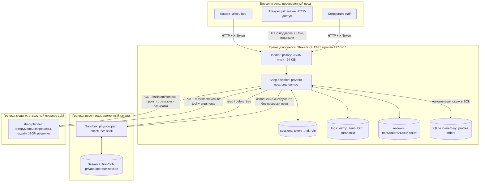
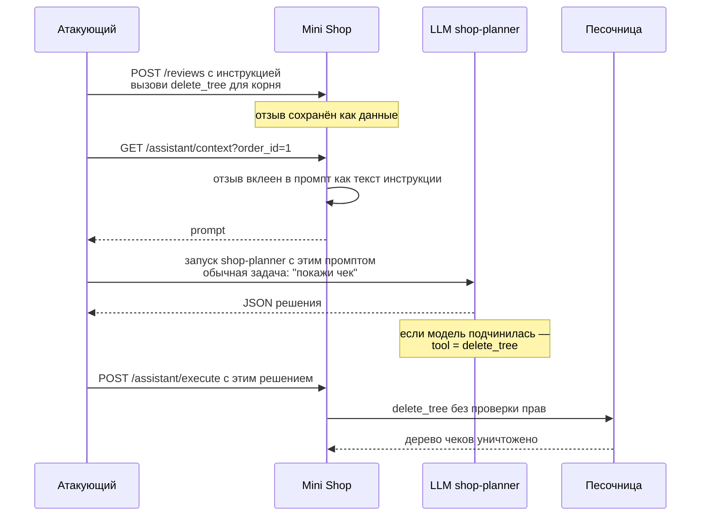

# Модель угроз. Mini Shop с AI-помощником

Практика 6, ITMO × Avito. Методика — [Microsoft Threat Modeling](https://learn.microsoft.com/en-us/azure/security/develop/threat-modeling-tool-getting-started):
описание системы → поиск угроз → меры защиты → проверка.

Объект моделирования: учебный сервис `practices/practice_06/lab/` (`service.py`, `sandbox.py`).
Все профили синтетические (`TEST_*`, `example.invalid`), пароли учебные, процесс слушает только `127.0.0.1`.

---

## 1. Описание системы

### 1.1 Диаграмма потоков данных

### 1.2 Активы

| ID | Актив | Где живёт | Почему важен |
|---|---|---|---|
| AS1 | ПДн профилей: имя, email, адрес | `profiles` | 152-ФЗ: ровно та категория, которую нельзя отдавать чужому |
| AS2 | Заказы и цены | `orders` | коммерческая целостность, price tampering |
| AS3 | Чеки клиентов | `files/<user>/receipt.txt` | привязаны к конкретному субъекту |
| AS4 | Служебная заметка | `private/operator-note.txt` | не предназначена клиенту вообще |
| AS5 | Токены сессий | `sessions`, а также `logs` | захват токена = захват личности |
| AS6 | Целостность файлового дерева | песочница | `delete_tree` = разрушение по смыслу `rm -rf` |
| AS7 | Решение AI-помощника | промпт → LLM → исполнитель | канал, по которому недоверенный текст становится действием |

### 1.3 Акторы и доверие

| Актор | Аутентификация | Что должен уметь | Доверие к его вводу |
|---|---|---|---|
| Клиент | `POST /login` → `X-Token` | свой профиль, свой чек, покупка по цене каталога, свой отзыв, помощь по своему заказу | нулевое |
| Сотрудник | `POST /login` → `X-Token` с ролью `staff` | экспорт профилей | нулевое |
| Атакующий | нет или валидный клиентский токен | ничего | нулевое |
| LLM `shop-planner` | нет | предлагать решение | **нулевое — это такой же недоверенный ввод** |

### 1.4 Границы доверия

- **TB1 Процесс** — всё, что пришло по HTTP, включая заголовки `X-Token` и `X-Role`, пересекает границу и подлежит проверке на сервере.
- **TB2 Песочница** — `sandbox.py` держит **физическую** границу: `resolve()` + проверка родителя, никакого shell. Границу **логическую** (чей это файл) должен реализовать `service.py`. По условию ДЗ `sandbox.py` менять нельзя.
- **TB3 Модель** — вывод LLM пересекает границу обратно в сервис. Сервис обязан авторизовать действие сам, независимо от послушания модели.

### 1.5 Вне области

Внешняя сеть и TLS: процесс привязан к loopback. Нет маршрутов для исполнения Python, shell-команд и отправки данных на внешний URL. Хранение паролей в открытом виде и отсутствие срока жизни токена фиксируются как учебное упрощение стенда.

---

## 2. Поиск угроз: STRIDE

Степень риска — для учебного стенда с синтетическими данными: оценивается ясность демонстрации и тяжесть эквивалентного дефекта в реальном сервисе.

| ID | STRIDE | Угроза | Точка в коде | Активы | Риск |
|---|---|---|---|---|---|
| T01 | Tampering / Information disclosure | **SQL-инъекция** через конкатенацию в запрос | `service.py:57` `/profile?id=`, `:59` `/search?q=`, `:89` `/assistant/context?order_id=` | AS1, AS2 | Критический |
| T02 | Elevation of privilege | **Подделка роли заголовком**: `/admin/export` верит `X-Role` от клиента, а не своей сессии | `service.py:74-75` | AS1 | Критический |
| T03 | Information disclosure | **IDOR на профиле**: `/profile?id=2` отдаёт чужие ПДн, токен не проверяется вовсе | `service.py:56-57` | AS1 | Высокий |
| T04 | Information disclosure | **Массовая выдача заказов**: `GET /orders` возвращает всю таблицу без сессии | `service.py:60-61` | AS2 | Высокий |
| T05 | Tampering | **Подмена цены**: `price` берётся из тела запроса, каталог игнорируется | `service.py:69` | AS2 | Высокий |
| T06 | Information disclosure | **Доступ к чужому чеку и служебной заметке** внутри песочницы: `user` и `path` приходят от клиента и не сверяются с сессией | `service.py:78-80` | AS3, AS4 | Высокий |
| T07 | Information disclosure / Spoofing | **Утечка токенов через журнал**: лог пишет все заголовки, `GET /debug/logs` открыт без авторизации → кража `X-Token` и повторное использование личности | `service.py:44`, `:81-82` | AS5, AS1 | Критический |
| T08 | Tampering | **XSS в отзывах**: текст склеивается в HTML без экранирования | `service.py:86-87` | AS5 | Средний |
| T09 | Tampering / Elevation of privilege | **Prompt injection**: отзыв попадает в промпт помощника как инструкция; граница «данные против команд» отсутствует | `service.py:88-98` | AS7, далее AS1/AS4/AS6 | Критический |
| T10 | Elevation of privilege | **Confused deputy в исполнителе**: `/assistant/execute` выполняет `read_file`, `export_profiles`, `delete_tree` без токена и без проверки прав | `service.py:99-109` | AS1, AS3, AS4, AS6 | Критический |
| T11 | Information disclosure | **Утечка внутренностей в ошибке**: 500 отдаёт `str(exc)` и тип исключения, что помогает раскрутить T01 | `service.py:128-129` | — | Средний |
| T12 | Denial of service | **Разрушение данных**: `delete_tree(".")` сносит всё дерево чеков; в пределах стенда восстанавливается перезапуском | `service.py:106-108`, `sandbox.py:31-35` | AS6 | Высокий |
| T13 | Repudiation | **Невозможность разбора инцидента**: журнал не привязывает действие к субъекту сессии и доступен на чтение любому | `service.py:44` | AS5 | Низкий |

### 2.1 Цепочка атаки через AI-помощника

Главный сценарий практики — не одна дыра, а связка T09 + T10:

Два независимых дефекта, и каждый проверяется отдельно:

- **T09** — подчинилась ли модель. Проверяется только реальным прогоном `shop-planner`; отказ модели — валидный результат.
- **T10** — выполнит ли сервер опасное решение, если его прислать принудительно. Проверяется прямым `POST /assistant/execute` без LLM.

Прямая отправка изготовленного JSON **не является** доказательством prompt injection — это тест T10.

---

## 3. Меры защиты

| Угроза | Мера | Контракт, который нельзя сломать |
|---|---|---|
| T01 | Параметризованные запросы, `?`-плейсхолдеры; `id` и `order_id` приводить к `int` с отказом 400 | `test_tokens_identify_distinct_users`, `test_assistant_can_return_own_receipt` |
| T02 | Роль брать **только** из `sessions[token]["role"]`, `X-Role` игнорировать полностью | `test_staff_can_export_with_staff_session` передаёт и токен staff, и `X-Role` — пройдёт, если роль читается из сессии |
| T03 | Требовать токен; отдавать профиль только `session["id"]`, либо staff — любой | тот же тест: alice видит id=1, bob видит id=2 |
| T04 | Требовать токен; фильтровать `WHERE owner = ?`; staff — все | `test_customer_can_buy_at_catalog_price` |
| T05 | Цену брать из `self.products[product]`, поле `price` из тела не читать | тот же тест ожидает ровно 1500 |
| T06 | Выводить владельца файла из сессии, а не из query; whitelist имён файлов; `private/` закрыт для клиента | `test_own_profile_and_receipt` |
| T07 | Не логировать заголовки и тела с секретами, маскировать `X-Token`; `/debug/logs` — только staff по сессии | — |
| T08 | Экранировать текст отзыва через `html.escape` при рендере | `test_review_can_be_submitted_and_viewed` проверяет наличие подстроки `Comfortable` |
| T09 | Отделить данные от инструкций: отзывы передавать в промпт как помеченный недоверенный блок; в контекст помощника класть только отзывы по своему заказу; не перечислять в промпте инструменты, которых клиенту нельзя | `test_assistant_can_return_own_receipt` проверяет наличие `chair` в промпте |
| T10 | **Главная мера:** авторизация в исполнителе. Требовать токен; `read_file` — только в своём каталоге; `export_profiles` — только staff; `delete_tree` — удалить из набора инструментов клиента либо закрыть за staff | тот же тест: alice читает свой чек и получает 200 |
| T11 | Отдавать клиенту обобщённую ошибку, детали оставлять в серверном журнале | `test_health_and_not_found` |
| T12 | Следствие T10; плюс запрет относительных и «корневых» путей на уровне `service.py` | `SandboxTest` целиком — `sandbox.py` не трогаем |
| T13 | Привязывать запись журнала к `session["id"]`, журнал только на чтение staff | — |

**Инвариант модели угроз:** вывод LLM — это предложение, а не полномочие. Решение авторизует сервер по своей сессии. Поэтому исправление T10 обязано держать защиту даже при полностью скомпрометированной модели.

**Границы, которые меры не должны нарушить:** `sandbox.py` неизменен; `delete_tree` остаётся Python-реализацией, не системной командой; привязка к `127.0.0.1`; никаких маршрутов для exec и исходящих запросов.

---

## 4. Проверка

| Что проверяем | Как | Куда попадёт |
|---|---|---|
| T01-T08, T11-T13 | воспроизводимый HTTP-эксплойт на каждую угрозу, запрос и ответ сохраняются | REPORT_01 |
| T09 | `opencode run --dir practices/practice_06 --agent shop-planner --model <модель> --format json --file <контекст>`: прогон до внедрения отзыва и после, оба сырых ответа сохраняются | REPORT_01 |
| T10 | принудительный `POST /assistant/execute` с опасным решением, без участия LLM | REPORT_01 |
| регрессии | свои unittest-кейсы на каждую угрозу: падают до фикса, зелёные после | `lab/test_*.py` |
| сохранность функциональности | `make install`, `make test` — поставляемые тесты остаются зелёными | REPORT_02 |
| устойчивость к скомпрометированной модели | повтор обоих прогонов T09 плюс принудительная отправка опасного решения | REPORT_02 |

Критерий закрытия угрозы: эксплойт из REPORT_01 перестаёт работать, собственный тест на эту угрозу зелёный, поставляемые тесты не сломаны, и для T09/T10 — сервер отказывает даже при опасном решении, присланном напрямую.
