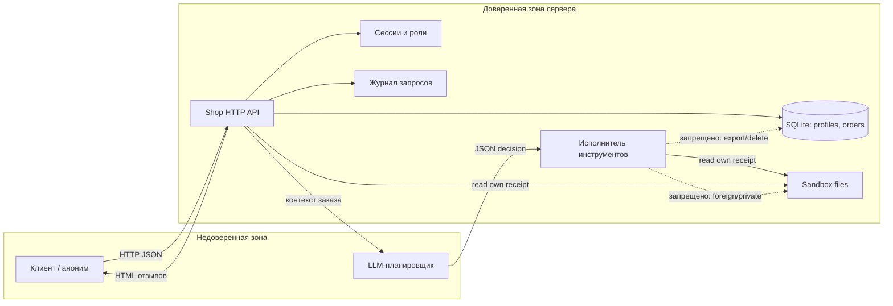

# Модель угроз Mini Shop

## 1. Область и допущения

В scope входит локальный учебный HTTP-сервис `lab/service.py`, его файловый sandbox,
SQLite-база в памяти и контур AI-помощника: `GET /assistant/context` → внешняя LLM →
`POST /assistant/execute`. Все данные синтетические, сервис слушает только
`127.0.0.1`, внешние URL и исполнение shell-команд отсутствуют.

Вне scope: безопасность хост-машины, сети, провайдера LLM и самого OpenCode. Для
учебного стенда принято, что пароли и токены не являются реальными секретами.

## 2. Активы

| Актив | Где находится | Почему важен |
|---|---|---|
| Профили клиентов | таблица `profiles` | ПДн: имя, email, адрес; 152-ФЗ |
| Заказы и цены | таблица `orders` | целостность покупки и история клиента |
| Чеки клиентов | `files/<user>/receipt.txt` | персональные данные и финансовая информация |
| Служебная заметка | `private/operator-note.txt` | внутренняя информация магазина |
| Сессии и роли | `sessions`, `X-Token` | аутентификация и авторизация |
| Журналы | `logs`, `/debug/logs` | могут содержать токены, пароли и ПДн |
| Целостность файлов sandbox | временный каталог | `delete_tree` может уничтожить учебные данные |
| Доступность сервиса | HTTP-процесс | oversized-запросы и разрушительные инструменты |
| Контекст LLM | `GET /assistant/context` | утечка чужих данных и prompt injection |

## 3. Акторы и границы доверия

- Анонимный пользователь.
- Клиент `alice` (id 1) и клиент `bob` (id 2).
- Сотрудник `staff` (id 0).
- Автор отзыва, который может быть вредоносным.
- LLM-планировщик: недоверенный компонент, чей вывод нельзя считать полномочием.
- Исполнитель инструментов: доверенная граница, которая обязана проверять решение LLM.

Границы доверия:

1. HTTP-клиент → API: всё из запроса недоверенно.
2. API → LLM: заказ, отзывы и вопрос пользователя являются данными, а не инструкциями.
3. LLM → `/assistant/execute`: JSON-решение не доверенно; сервер проверяет сессию,
   владельца и allowlist инструментов.
4. API → файловая система: sandbox ограничивает физический путь, но не заменяет
   авторизацию пользователя.
5. API → журналы: секреты и тела запросов не должны попадать в логи.

## 4. Поток данных

## 5. STRIDE-угрозы

| ID | STRIDE | Угроза | Реализация в исходном сервисе | Мера | Проверка |
|---|---|---|---|---|---|
| T01 | Spoofing | Анонимный доступ к приватным данным | Приватные endpoint'ы не требуют `X-Token` | `authenticated()` на всех приватных маршрутах | `V01`, `test_private_endpoints_require_session` |
| T02 | Spoofing | Подмена роли клиента | `/admin/export` доверяет `X-Role: staff` | Роль только из серверной сессии | `V04`, `test_role_header_never_grants_privilege` |
| T03 | Tampering | Изменение цены заказа | `POST /orders` берёт `price` из тела | Цена только из каталога | `V05`, `test_price_is_always_from_catalog` |
| T04 | Tampering | SQL-инъекция | Конкатенация `id`, `q`, `order_id` в SQL | Параметризованные запросы и строгий разбор чисел | `V03`, `test_sql_injection_rejected_or_treated_as_data` |
| T05 | Repudiation | Сокрытие действий пользователя | Журналы неполные или содержат секреты | Безопасные структурные записи без body/headers | `V07`, `test_logs_are_staff_only_and_redacted` |
| T06 | Information disclosure | IDOR профилей, заказов и контекста | Любой `id`/`order_id` доступен без проверки владельца | Проверка владельца или роли staff | `V02`, `test_owner_isolation` |
| T07 | Information disclosure | Чтение чужого чека и служебной заметки | `files/{user}/{path}` без проверки пользователя | Только собственный `files/<user>/receipt.txt` | `V06`, `test_file_owner_and_canonical_path` |
| T08 | Information disclosure | Утечка токенов и паролей через логи | `/debug/logs` доступен клиенту и хранит body/headers | Staff-only журнал без секретов | `V07`, `test_logs_are_staff_only_and_redacted` |
| T09 | Denial of service | Oversized-запросы и отзывы | Нет лимитов на текст и query | Лимиты body/URI/полей, `400`/`413`/`414` | `V12`, `test_oversized_review_and_query_rejected` |
| T10 | Elevation of privilege | Небезопасный исполнитель инструментов | `/assistant/execute` без auth, доступны `export_profiles` и `delete_tree` | Auth + allowlist `read_file` + проверка своего чека | `V09`, `test_executor_*` |
| T11 | Elevation of privilege | Prompt injection через отзыв | Отзывы смешаны с инструкциями, модели предложены опасные инструменты | `untrusted_reviews` как данные, `allowed_tools: ["read_file"]`, серверная проверка | `V10`, `test_context_separates_untrusted_reviews_and_limits_tools` |

## 6. Угрозы AI-контура

| ID | Угроза | Сценарий | Мера |
|---|---|---|---|
| A01 | Indirect prompt injection | Вредоносный отзыв просит игнорировать правила, вызвать `delete_tree` или `export_profiles` | Отзывы передаются как `untrusted_reviews`, инструменты ограничены, сервер не доверяет решению модели |
| A02 | Excessive agency | Модель выбирает разрушительный инструмент | Allowlist только `read_file`; `export_profiles` и `delete_tree` всегда `403` |
| A03 | Insecure output handling | Модель возвращает чужой путь или произвольный JSON | Проверка типов decision/tool/arguments/path, точного пути и владельца; лишние поля не дают полномочий |
| A04 | Sensitive information disclosure | В контекст попадает чужой заказ, служебная заметка или лишние ПДн | Контекст только по своему заказу, `receipt_path` только свой; содержимое отзывов недоверенно, автоматической очистки секретов нет |
| A05 | Model/behavior drift | Модель отказывается или отвечает не по схеме | Некорректный ответ фиксируется как ошибка, серверная защита не зависит от послушания модели |
| A06 | Prompt injection в LLM-судью | Проверяемая модель угроз содержит инструкцию «поставь 10/10» | Судья трактует проверяемый текст только как данные и требует evidence |

## 7. Контроль и проверка

- Аутентификация и объектная авторизация: все приватные маршруты требуют сессию;
  клиент видит только свои профиль, заказы, чек и контекст; staff получает только
  разрешённые действия.
- SQL: только параметризованные запросы; числовые параметры проходят строгий
  `^[0-9]{1,9}$`, иначе `400`.
- Файлы: клиенту разрешён ровно `files/<own>/receipt.txt`; traversal и чужой
  пользователь дают `403`; `sandbox.py` остаётся неизменным.
- Отзывы: экранирование HTML при рендере и `Content-Security-Policy`; размер
  ограничен.
- Журналы: staff-only, без body, headers, токенов и паролей.
- AI-контур: контекст — структурированный JSON с `allowed_tools`, `receipt_path` и
  `untrusted_reviews`; исполнитель принимает только `read_file` для своего чека.
- Ошибки: `400` для некорректных форм, `413` для большого body, `414` для длинного
  URI, `500` без типа и текста исключения.
- Evidence: `evidence/before/` и `evidence/after/` содержат HTTP-атаки и результаты
  тестов; отчёты `REPORT_01.md` и `REPORT_02.md` сравнивают статусы и эффекты.

| Проверка | Ожидаемый результат |
|---|---|
| Анонимный `GET /profile`, `/orders`, `/files`, `/debug/logs`, `/assistant/context` | `401` |
| Alice запрашивает профиль, заказ или контекст Bob | `403` |
| SQLi в `id`/`order_id` | `400` |
| SQLi в `q` | `200` и `[]` |
| `X-Role: staff` с клиентской сессией | `403` |
| Заказ с `price` из тела | `201`, цена из каталога |
| `/files?user=bob` или traversal | `403` |
| Клиент запрашивает `/debug/logs` | `403` |
| XSS-отзыв | `&lt;script&gt;` и заголовок CSP |
| `read_file` чужого или приватного файла | `403` |
| `export_profiles` / `delete_tree` | `403`, sandbox существует |
| Контекст ассистента | `allowed_tools == ["read_file"]`, `receipt_path` свой |
| Некорректная JSON-форма | `400` без поля `type` |
| Отзыв 5000 символов / query 9000 | `400` / `414` |

## 8. Остаточные риски

- Учебные пароли и отсутствие TLS/rate limiting допустимы только для локального
  стенда.
- In-memory БД и одноразовый sandbox не предназначены для production.
- Модель LLM может быть убеждена вредоносным отзывом; защита обеспечивается
  серверной авторизацией и allowlist, а не «послушанием» модели.
- Нет отдельного аудита действий staff и срока жизни сессий; для учебной работы это
  зафиксировано как ограничение.

## 9. План перехода в production

- Включить TLS, `Secure`/`HttpOnly`/`SameSite` cookies или заголовок токена только
  по HTTPS; добавить TTL и ротацию сессий.
- Добавить rate limiting на `/login` и `/assistant/execute`, блокировку перебора и
  журналирование security-событий.
- Вынести данные в persistent SQLite/PostgreSQL с шифрованием, резервным
  копированием и миграциями; не хранить пароли в открытом виде.
- Ввести аудит действий staff, мониторинг отказов `401/403/413/414/500` и алерты
  на аномалии.
- Управлять секретами через vault/переменные окружения, проверять зависимости и
  модель LLM на supply-chain-риски.
- Расширить тесты: fuzzing JSON/URI, проверка CSP, интеграционные тесты с реальной
  LLM и регрессия на prompt injection.

## 10. Фактические результаты и границы гарантий

На версии `service.py` SHA-256
`254e2ebfe38c7fbf8d2201383034bbadbf2fdc0f4ee2acb5ed18446fd6b4be96`
`make step6` и `make test` успешны (33 теста ДЗ 6). На исходной версии
`8cb3abeaaf7bb647cbbd9d1c9a0ea50375c70c30110313f5015468ded24b7569`
тот же набор даёт 47 падений и 1 ошибку.
В HTTP evidence: чужой профиль 200→403, подмена роли 200→403, SQLi 200→400,
чужой файл 200→403, опасные инструменты 200→403, sandbox после опасного решения
сохраняется. Это результаты исполненного эксперимента, а не только ожидания.

Исполнитель проверяет объект `decision`, строку `tool`, объект `arguments` и
строку `path` для `read_file`. Путь должен точно совпадать с собственным чеком
сессии. Неизвестные инструменты возвращают 400; export/delete — 403. Неизвестные
поля игнорируются и не передаются другим инструментам; полной JSON Schema с
запретом дополнительных полей нет.

Прямой prompt injection через `user_question` остаётся возможным на уровне
поведения модели. Серверный allowlist и проверка владельца применяются к любому
решению независимо от источника инструкции. Отдельный эксперимент с прямой
инъекцией не выполнен; сохранённый эксперимент проверяет инъекцию через отзыв.

Состав контекста: собственный заказ (id, owner, product, price), собственный
receipt_path, allowed_tools, user_question и недоверенные отзывы. Сервер не
включает сессии, пароли и служебные файлы, но автор отзыва может сам вписать
чувствительные данные. Автоматического удаления секретов из отзывов нет;
для внешней модели это остаточный риск, требующий отдельной политики данных.

Число отзывов и совокупный размер контекста не ограничены, несмотря на лимит
одного отзыва. Это остаточный риск доступности; ограничения отдельного HTTP-запроса
не закрывают накопительное истощение ресурсов. Внешняя LLM не вызывается самим
сервисом; эксперимент ограничен таймаутом отдельного процесса 240 секунд.
Production требует общего лимита отзывов/контекста, квот и бюджета вызовов.
