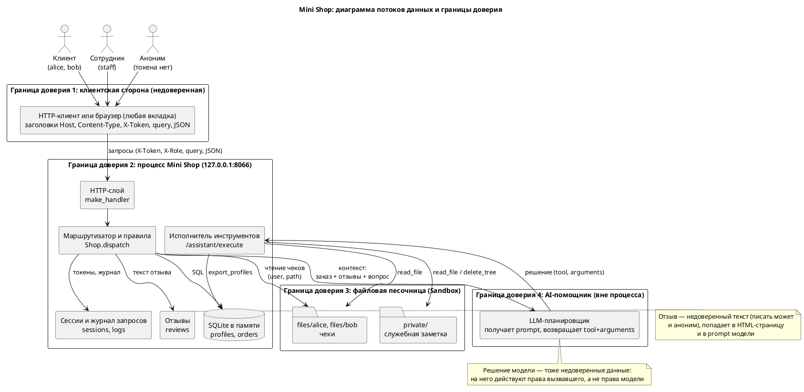

# Модель угроз Mini Shop

Метод — Microsoft Threat Modeling: описание системы, поиск угроз (STRIDE по
каждому потоку данных и хранилищу), меры защиты, проверка. Объект —
учебный магазин `lab/service.py`; всё запускается только на `127.0.0.1` с
синтетическими данными. Модель описывает **исходную** версию сервиса; колонка
«Тест» показывает, чем мера проверена после исправления.

Версия 3. Версия 2 доработана после первого вердикта независимого судьи
(`evidence/judge-verdict-1.json`, `reject`): добавлены серьёзность, матрица
STRIDE, угрозы T17–T21. Версия 3 — после второго вердикта
(`evidence/judge-verdict-2.json`, `accept_with_fixes`): угроза T22, остаточные
риски, исправленные категории и формулировки. Третий прогон судьи не делался.

Исходник схемы: [`threat-model.puml`](threat-model.puml).

## 1. Описание системы

| Элемент | Что это | Что защищаем |
|---|---|---|
| Клиент (`alice`, `bob`) | в исходной версии токен проверяет только `POST /orders`; остальные маршруты его игнорируют | свои профиль, заказы, чек; чужие — нет |
| Аноним | любой, кто достучался до порта: токена нет, в том числе чужая веб-страница в браузере владельца | публично только `/health`, `/products`, `/login` и **чтение** `/reviews/view` (после экранирования); всё остальное — по сессии |
| Сотрудник (`staff`) | вошёл по логину | выгрузка профилей и журнал — только ему |
| Каталог | `products` | цена задаётся сервером |
| БД | профили (ПДн: имя, e-mail, адрес), заказы | конфиденциальность и целостность |
| Файлы | чеки клиентов в `files/<имя>/`, `private/` | чеки — владельцу, `private/` — никому |
| Отзывы | текст от пользователей, в исходной версии — **от анонимов** | попадает в HTML-страницу и в prompt модели **всех** пользователей |
| AI-помощник | модель возвращает `tool` + `arguments`, сервер исполняет | у модели нет прав больше, чем у вызвавшего |

**Границы доверия.** (1) всё, что приходит от клиента: тело, query,
**заголовки** — недоверенно; (2) процесс магазина; (3) файловая песочница
(`sandbox.py` держит только физическую границу каталога, но **внутри** неё
разграничения нет); (4) модель: её вывод — такие же недоверенные данные, как
ввод пользователя, и решение приходит в `/assistant/execute` по HTTP, сервер
не отличает «ответ модели» от запроса злоумышленника. (5) браузер владельца и другие процессы той же машины: `127.0.0.1` — не граница доверия, потому что чужая вкладка может отправлять запросы на этот порт.

**Активы и последствия.** ПДн клиентов (152-ФЗ), целостность цен и заказов,
служебная заметка, учётные данные и токены, доступность.

## 2. Угрозы

Категории STRIDE: **S** подмена, **T** искажение, **R** отказ от действий,
**I** раскрытие, **D** отказ в обслуживании, **E** повышение привилегий.
Серьёзность: **В** высокая (ПДн, потеря данных, действия от чужого имени),
**С** средняя, **Н** низкая.

| ID | Серьёзность | STRIDE | Где | Угроза | Последствие | Мера | Тест |
|---|:-:|---|---|---|---|---|---|
| T01 | В | E | заголовок `X-Role` → `/admin/export` | роль берётся из заголовка клиента, а не из сессии | любой получает выгрузку ПДн | роль только из серверной сессии; нет сессии — 401 | `t01` |
| T02 | В | I | `/profile?id=` | нет ни входа, ни проверки владельца | чужой профиль (ПДн) | владелец из сессии; чужой `id` — 403 | `t02` |
| T03 | В | I, D | `/profile`, `/search`, `/assistant/context` | пользовательский ввод подставляется в SQL строкой | чтение чужих данных БД; тяжёлый запрос под общим `shop.lock` замораживает сервис (код выполняет один оператор, изменение данных через эти входы не заявляется) | параметризованные запросы, числовые `id` проверяются | `t03` |
| T04 | С | I | `GET /orders` | заказы всех без входа и без фильтра | чужие заказы | заказы вызвавшего; сотрудник — по роли из сессии | `t04` |
| T05 | В | T | `POST /orders`, поле `price` | цена принимается от клиента | покупка за любую цену | цена только из каталога; владелец из сессии | `t05` |
| T06 | В | I | `GET /files?user=&path=` | путь собирается из `user` и `path`, владелец не проверяется, входа нет; граница песочницы не спасает, потому что `private/` внутри неё | чужие чеки и служебная заметка | `user` принадлежит владельцу сессии (сотрудник — любой известный), `path` — простое имя файла | `t06` |
| T07 | В | I, S | `self.logs`, `GET /debug/logs` | журнал хранит **заголовки и тела запросов**, то есть `X-Token` и пароли из `POST /login`, и отдаётся без входа | кража учётных данных, включая `staff` | в журнал не пишутся заголовки, тела и query; маршрут только для сотрудника | `t07` |
| T08 | С | T | `POST /reviews`, `/reviews/view` | отзыв пишет аноним любой длины, текст выводится в HTML как есть | сохранённый XSS у каждого, кто откроет страницу | вход обязателен; товар из каталога, текст 1–1000; `html.escape` при выводе (причина), CSP и `nosniff` (второй эшелон) | `t08` |
| T09 | С | T, E | отзывы → prompt | недоверенный текст попадает в prompt всех пользователей и читается моделью как инструкция | косвенная prompt injection; отравление контекста всех клиентов одним отзывом | в prompt — только отзывы заказанного товара, не более 20, помечены недоверенными; **главная мера — серверная авторизация инструментов (T10–T12, T18)**, а не послушание модели | `t09` |
| T10 | В | E | `/assistant/execute` → `read_file` | решение исполняется с правами сервера, путь не проверяется | чтение чужих чеков и `private/` | путь только `files/<владелец сессии>/<имя>` | `t10` |
| T11 | В | E, I | `/assistant/execute` → `export_profiles` | любой вызвавший получает выгрузку ПДн | утечка всех профилей | инструмент только для роли `staff` из сессии | `t11` |
| T12 | В | D, T | `/assistant/execute` → `delete_tree` | деструктивный инструмент доступен вызвавшему | потеря чеков | инструмент недоступен никому через помощника; удаление — только человеком вне канала модели | `t12` |
| T13 | С | S, I, D | `/login`, токены | нет лимита попыток, токен бессрочный; ответ может выдавать, какие имена существуют | подбор пароля, долгоживущий токен, перечисление имён | 5 неудач за 60 с по имени, известному или нет, — 429; срок жизни токена 1 час | `t13` |
| T14 | Н | I | любая ошибка | `500` отдаёт текст исключения и его тип, в том числе абсолютный путь временного каталога | раскрытие устройства сервера | клиенту — общий ответ, подробности только в консоль сервера | `t14` |
| T15 | Н | D | тела запросов | форма тела не проверяется (`body["product"]`, не-объект, неверные типы) | необработанные исключения, 500 | проверка формы: 400 вместо 500 | `t15` |
| T16 | Н | R | действия пользователей | нет журнала действий с привязкой к пользователю | не восстановить, кто что сделал | журнал аудита: пользователь, действие, исход; без секретов | `t16` |
| T17 | В | I | `GET /search`, `GET /assistant/context` | **нет аутентификации и проверки владельца**; параметризация T03 этого не закрывает | аноним получает профили (ПДн) и чужие заказы | вход обязателен; клиент видит только свои данные, поиск по всем — только `staff` | `t17` |
| T18 | В | S, E | `POST /assistant/execute` | **вообще нет сессии**: решение приходит по HTTP от кого угодно, модель для атаки не нужна | любой аноним вызывает `read_file`, `export_profiles`, `delete_tree` | вход обязателен; всё остальное — по роли и владельцу из сессии | `t18` |
| T19 | В | D, T | `Sandbox.path`, `delete_tree` | песочница считает допустимым сам корень; удаление корня сносит все чеки и `private/` | потеря всех учебных файлов | `delete_tree` недоступен (T12), пути `.`, `files`, `private` проверены на уровне сервиса; `sandbox.py` не менялся — **остаточный риск** (раздел 4) | `t12` |
| T20 | С | D | `logs`, `reviews`, `sessions`, потоки, чтение тела | списки и сессии растут без предела; зависший клиент держит поток | исчерпание памяти и потоков одним клиентом | пределы: журнал 1000, отзывы 200, не более 10 сессий **на учётную запись** (иначе один клиент вытесняет токен сотрудника), таблица неудачных входов 1000 имён; тайм-аут сокета 10 с, 408 | `t20` |
| T21 | С | S, I | `Shop.accounts`, `/login` | учебные пароли лежат в коде открытым текстом, сравнение `!=` | компрометация исходников даёт пароли | сравнение `hmac.compare_digest` по байтам (не-ASCII не даёт 500); **хранение паролей не меняем**: пароли — фикстура стенда, известная из README; для реального сервиса — хэши (scrypt/argon2) | — (принято) |
| T22 | С | S, T | заголовки `Host`, `Content-Type`; сетевой слушатель `127.0.0.1` | сервер не проверяет `Host` и разбирает тело как JSON при любом `Content-Type`: «простой» кросс-сайтовый POST (`text/plain`) не требует preflight, а DNS rebinding подставляет свой `Host` | чужая веб-страница в браузере владельца выполняет запросы к стенду, при rebinding читает ответы | допустимы только `Host` вида `127.0.0.1:<порт>` и `localhost:<порт>` (иначе 403); POST с телом — только `application/json` (иначе 415) | `t22` |

### Матрица STRIDE: поток или хранилище × категория

Число — угроза из таблицы; «—» — рассмотрено, неприменимо. Общие причины для «—»:
у потока нет такой поверхности (например, **S** у `/files`, `/orders`, `/admin/export`:
личность берётся из уже проверенной сессии; **E** у `/orders`: роль не участвует);
запрос только читает данные (**T**); действие не оставляет следа, который можно
оспорить (**R**). Сетевая подмена источника запроса (**S**) для потоков, куда
пишет браузер, — T22.

| Поток или хранилище | S | T | R | I | D | E |
|---|---|---|---|---|---|---|
| `POST /login` | T13, T21 | — (только чтение учётных данных) | T16 | T13 (ответы 401 одинаковы для любого имени) | T13 | — |
| `/profile` | T22 | — (запросы только читают) | — | T02, T03 | T03, T15 | T01 |
| `/search` | T22 | — | — | T17, T03 | T03, T15 | — |
| `/orders` (GET, POST) | — | T05, T15 | T16 | T04 | T15 | — |
| `/admin/export` | — | — | T16 | T01 | — | T01 |
| `/files` | — | — | — | T06, T14 (путь в тексте ошибки) | T15 | — |
| `/debug/logs` | T07 (кража токенов) | — | T16 | T07 | T20 | T07 |
| `POST /reviews` и `/reviews/view` | T08 (аноним) | T08 | T16 | — | T20 | — |
| `/assistant/context` | T22 | T09 | — | T17, T03 | T03, T20 | T09 |
| `/assistant/execute` | T18, T22 | T12, T19, T22 | T16 | T10, T11 | T12, T20 | T10, T11, T18 |
| `/health`, `/products` | — | — | — | — (публичные данные) | T20 | — |
| БД `profiles`, `orders` | — | T03, T05 | T16 | T02, T03 | — | — |
| `sessions` | T13 | — | — | T07 | T20 | — |
| `logs`, `reviews` | — | T08, T09 | T07 | T07 | T20 | — |
| `sandbox` | — | T12, T19 | — | T06, T10 | T19 | — |
| LLM-планировщик | — | T09 | — | T09 | — | T09, T10–T12 |

## 3. Принципы исправления

1. **Идентичность и роль определяет сервер** по сессии, никогда клиентский заголовок. Нет сессии — нет доступа ни к чему, кроме публичных маршрутов.
2. **Права проверяются на сервере для каждого действия**, в том числе действия, которое «предложила» модель: исполнитель не знает, модель это или человек.
3. **Недоверенные данные не меняют смысл запроса**: SQL — параметрами, HTML — экранированием, пути — только из допустимого набора.
4. **Модель — не граница безопасности.** Серверная авторизация не даёт модели прав сверх прав вызвавшего: клиент не получит чужого, даже если модель выполнит любую инструкцию. Но от имени сотрудника сервер исполнит то, что сотруднику разрешено, — это остаточный риск (раздел 4). Пометка «недоверенные данные» в prompt лишь снижает шанс, но не мера.
5. **Ошибки и журналы не раскрывают секреты и внутренности**; журнал не хранит заголовков и тел запросов.
6. **Всё, что растёт от внешнего ввода, ограничено**.
6. **Всё, что растёт от внешнего ввода, ограничено**, и лимит не должен становиться рычагом (на учётную запись, а не общий).
7. **`127.0.0.1` — не граница доверия**: запросы проверяются так, будто они пришли из чужой веб-страницы.

## 4. Остаточные риски (приняты или вне области стенда)

| Риск | Почему остаётся | Условие |
|---|---|---|
| Confused deputy для `staff`: косвенная инъекция в отзыве может заставить модель вызвать `export_profiles` или `read_file` **от имени сотрудника**, проверка роли пройдёт | у сотрудника эти действия разрешены функциональностью стенда; мера — подтверждение человеком вне канала модели, на стенде не реализована | помощник для сотрудника не должен исполнять решения модели без подтверждения |
| Блокировка входа: тот, кто знает имя учётной записи, может держать её в 429 | компромисс лимита попыток; альтернатива — задержка и счёт по источнику | не применимо к стенду с одним локальным клиентом |
| Журнал аудита хранится в памяти (1000 записей), вытесняется и теряется при перезапуске | вне стенда: запись в файл или внешнюю систему | для реального сервиса — отдельное хранилище |
| `sandbox.py` считает допустимым путь «корень», дефект остаётся в модуле | модуль менять нельзя по условию; закрыто на уровне сервиса (T12, T19) | не вызывать `Sandbox.delete_tree` и `read` с путями из клиентского ввода |
| Пароли хранятся открытым текстом (T21) | фикстура стенда, пароли из README | для реального сервиса — scrypt или argon2 |
| Отзыв может отравить prompt для заказанного товара (T09) | пометка и ограничение объёма не отделяют атакующего от жертвы | см. первую строку: единственная настоящая мера — авторизация инструментов |
